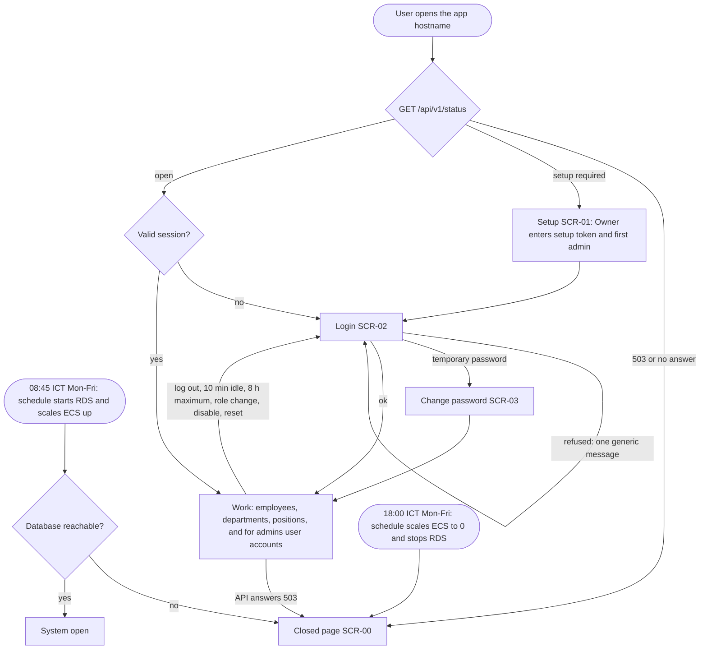
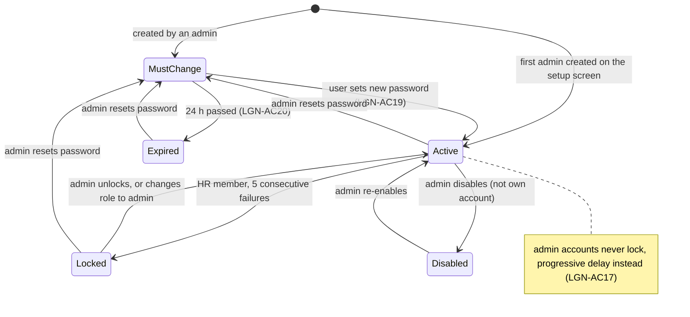
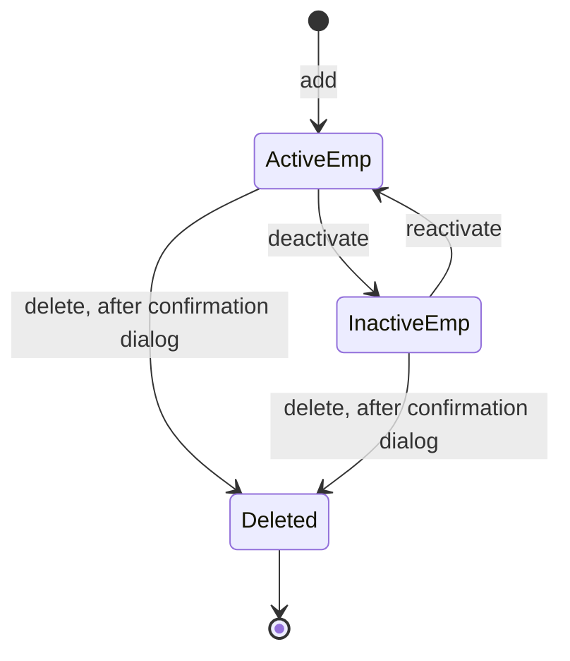
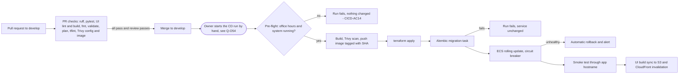
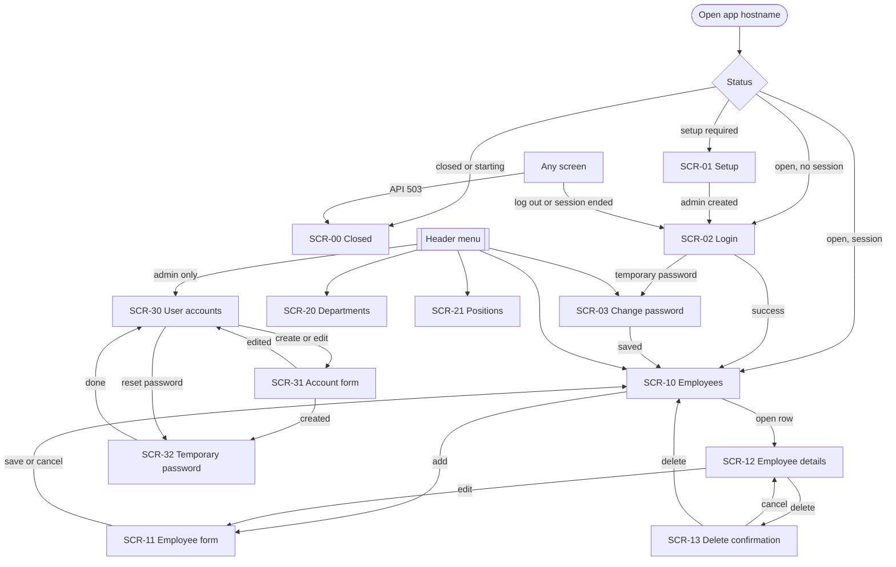
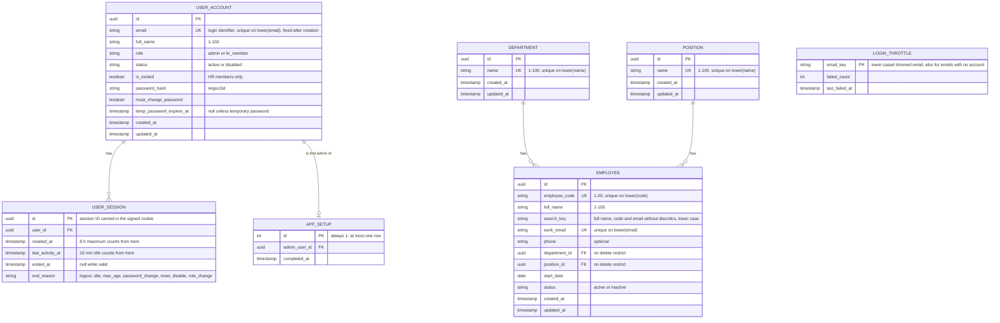

# Spec 001: CMS employee records system

| | |
| --- | --- |
| Spec ID | spec-001 |
| Source intent | `docs/intent/intent-001.md` (approved 2026-10-13, revised 2026-10-13 with the Owner's answers to Q-O1 to Q-O7, revised 2026-10-31 with the Owner's decisions on roles, session, lockout, password and first admin) |
| Additional sources (infrastructure) | Owner's direction of 2026-10-14 (focus on the infrastructure and container parts; application scope kept unchanged). The architecture diagram `20261003_02_high_level_architecture.png` at the repo root, approved by the Owner as-is ("ARCH" below). `CLAUDE.md` at the repo root (tech stack, Terraform layers, container rules, workflow list and pipeline flow). |
| Additional sources (2026-10-31) | Owner decisions of 2026-10-31 on Q-O8 to Q-O12 and the two-role model, as relayed and clarified by the PM/SM; PM/SM security safeguards of 2026-10-31 (admin brute-force protection, setup token); Product Owner defaults for Q-O13 to Q-O53 under the decision tiers of workflow section 8. All are listed in the "Decisions log". |
| Status | Acceptance criteria and NFR approved by the Owner at G1 (`docs/gates/G1.md`). Basic Design added by the Dev Lead on 2026-11-01, draft for Owner approval at G2 |
| Sections | "Acceptance Criteria" and "NFR", written by the Product Owner (workflow Phase A, Steps 3 and 3b); "Basic Design", written by the Dev Lead (Steps 4 and 4b) |
| Remaining sections | None. The Basic Design sections (architecture check, business flow, screen list and transitions, logical ER diagram, API conventions, functional specification, infrastructure layout, NFR overview) are now present in "Basic Design", written by the Dev Lead at Step 4b on 2026-11-01 for approval at G2. The function list is `docs/specs/function-list.md`. Detailed design is in each story's plan. |
| Process | `docs/process/ai-native-sdlc-workflow.md` v3 |

## How to read this file

- **IDs.** Acceptance criteria are grouped by requirement. The ID format is `<GROUP>-AC<NN>`. User stories are assigned at Step 5; the backlog will map each story to these IDs, so the IDs here do not change.

  | Prefix | Requirement group | Intent reference |
  | --- | --- | --- |
  | `LGN` | Login, session and access control (both roles) | 5.1 item 1; 7 items 4 and 6 |
  | `ROLE` | Roles and permissions (added 2026-10-31) | 4; 5.1 items 1 and 2 |
  | `ACC` | User account management, admin only (replaces `ADM`, 2026-10-31) | 5.1 item 2 |
  | `SETUP` | First admin setup (added 2026-10-31) | 5.1 item 2 |
  | `EMP` | Employee profiles | 5.1 item 3; 7 item 2 |
  | `ORG` | Departments and positions | 5.1 item 4 |
  | `SCH` | Scheduled stop/start and closed page | 5.1 item 5; 6.2; 8 item 2 |
  | `LNG` | Language switching | 5.1 item 6 |
  | `IAC` | Infrastructure as code: Terraform layers, state, workspaces, modules, static checks, reproducible build | 6.1; 6.3; ARCH; `CLAUDE.md` |
  | `NET` | Network: VPC, subnet tiers, internet reachability, security-group paths, DNS | 6.1; 7 item 4; ARCH; `CLAUDE.md` |
  | `CNT` | Container image: build, base image, non-root user, health endpoint, scan gate, tagging, ECR, local run | 6.1; ARCH; `CLAUDE.md` |
  | `CICD` | Pull-request checks, OIDC, delivery on merge to `develop`, migration, rolling deploy and rollback, smoke test, UI publish, failure behaviour | 6.1; 6.5; ARCH; `CLAUDE.md` |
  | `SEC` | Infrastructure security: TLS, WAF, KMS encryption, secrets handling, CloudTrail, GuardDuty, least privilege | 7 items 3, 4 and 5; ARCH; `CLAUDE.md` |
  | `OBS` | Observability: logs, alarms, dashboard, notifications, alarm tests | 8 item 3; ARCH; `CLAUDE.md` |
  | `SCALE` | Sizing profiles, auto scaling, Multi-AZ, load check, backups | 6.4; 8 item 3; ARCH; `CLAUDE.md` |
  | `COST` | Budget alerts and sizing discipline | 6.4; ARCH; `CLAUDE.md` |
  | `TDN` | Teardown and clean-up checklist | 6.3; 8 item 4; `CLAUDE.md` |

- **Renamed group (2026-10-31).** `ADM` (Admin management) became `ACC` (User account management) when the Owner introduced two roles. `ADM-AC01` to `ADM-AC10` became `ACC-AC01` to `ACC-AC10` with the same number and the same subject, now covering accounts of both roles. `ADM-AC11` (one role) is replaced by `ROLE-AC01` to `ROLE-AC05`. `ADM-AC12` (first admin) is replaced by `SETUP-AC01` to `SETUP-AC06`. `ACC-AC11` (unlock) and `ACC-AC12` to `ACC-AC14` (edit full name and role) are new. The `ADM` prefix is no longer used.
- **Users and roles.** "User" means a person with a user account, of either role. "Admin" and "HR member" name the two roles (ROLE group). "Logged-in user" means a user with a valid session, of either role. Employees are records, not users, and never log in.
- **Open markers.** A criterion that starts with `[OPEN Q-Oxx]` depends on a value only the Owner holds; the text after the marker says what is already decided and what is missing. A criterion that starts with `[OPEN Q-Dxx]` depends on a design decision owned by the Dev Lead (proposed at Step 4b, decided by the Owner at G2). The missing part is not a requirement, and QA does not write a test for it, until the question is answered. Criteria that use the "app hostname" or the "alert address" are decided and QA can write their tests now; they can only be run once Q-O37 and Q-O38 are answered.
- **Decisions.** Every value in this spec that was not stated by the Owner, ARCH or `CLAUDE.md` is a recorded default in the "Decisions log", marked with who decided it. The Owner can override any of them at G1.
- **Refused / rejected.** "Refused" means the action has no effect and the response contains no employee, department, position or user account data. Exact HTTP status codes and screen layouts are set by the Dev Lead in Basic Design.
- **Error on a field.** The error message is displayed next to the named field, in the currently selected language, and the form keeps the values the user entered (password fields may be cleared).
- **Test data.** All tests use only `testdata/mock/`.
- **Infrastructure terms** (IAC to TDN groups only).
  - "App hostname": the public hostname of `dev01` served by CloudFront, `dev01.cms.imaprof.ink` in the hosted zone `cms.imaprof.ink` (Q-O37; ARCH still shows `dev01.userhub.<domain>`, and the rename is Q-D6).
  - "Alert address": the email address subscribed to the SNS alert topic (Q-O38), passed as a variable that is never committed.
  - "Lean profile" / "full profile": the env layer applied with `awsenv/dev/env/tfvars/dev01.tfvars` / `dev01_full.tfvars`.
  - "Delivery run": the GitHub Actions run triggered by a merge to `develop`.
  - "Full verification": the run of done-criterion 3 (intent section 8) on the full profile.
  - "Check:" names one way QA can observe the outcome (AWS CLI, Terraform output, a request from the internet, a pipeline run). It is a verification hint, not a design.

## Acceptance Criteria

### LGN: Login, session and access control

Trace: intent 5.1 item 1, 7 items 4 and 6; Q-O3, Q-O8, Q-O9, Q-O10, Q-O13, Q-O16; D-PM1; D-PO1 to D-PO3. The login screen and the login rules are the same for both roles unless a criterion names a role.

- LGN-AC01: An active user of either role who submits their email and correct password is logged in and can open the employee list. The email is compared ignoring upper and lower case and surrounding spaces. Test points: an admin and an HR member each log in from the same login screen; `HR1@Example.test ` (upper case, trailing space) logs in the account `hr1@example.test`.
- LGN-AC02: A login with a wrong password, or with an email that belongs to no user account, is refused: no session is created, the message of LGN-AC15 is displayed, and the employee list cannot be opened. Test point: logging in with the work email of an employee record that has no user account is refused the same way.
- LGN-AC03: Every request for employee, department, position or user account data made without a valid session is refused, for read and for write operations. This covers each data operation in the EMP, ORG and ACC groups.
- LGN-AC04: Opening any application screen other than the login screen (and, while no admin account exists, the setup screen of SETUP-AC01) without a valid session shows the login screen and displays no employee, department, position or user account data.
- LGN-AC05: A session with no user action for 10 minutes is ended. A user action is any request to the API started by the user (opening a screen, saving, searching, paging, deleting); requests the UI makes on its own without a user action do not count. Test points: after 9 minutes with no user action the next action succeeds; after 11 minutes with no user action the next action is refused and the login screen is shown.
- LGN-AC06: Each user action restarts the 10-minute idle count. Test point: a user who acts once every 5 minutes for 30 minutes is still logged in at the end.
- LGN-AC07: A session ends 8 hours after the login that started it, whatever the activity. Test points: a user who acts every 5 minutes has an action at 7 hours 55 minutes succeed; the first action after 8 hours 5 minutes is refused and the login screen is shown; a new login then succeeds and starts a new 8-hour session.
- LGN-AC08: A log-out action is available on every application screen for both roles. After logging out, the login screen is shown, and a request that presents the previous session (for example a replayed session cookie or token) is refused. Logging out ends only that session.
- LGN-AC09: Wherever a password is chosen (setup screen, forced change of LGN-AC19, own change of LGN-AC21), a password shorter than 12 or longer than 128 characters is rejected with an error on the password field. Test points, each otherwise meeting LGN-AC10: 11 characters rejected; 12 characters accepted; 128 characters accepted; 129 characters rejected.
- LGN-AC10: Wherever a password is chosen, it must contain at least one upper-case letter, one lower-case letter, one digit (0-9) and one special character; otherwise it is rejected with an error on the password field that names each missing class. Letters include letters with Vietnamese diacritics (`Đ` counts as upper-case, `ư` as lower-case). A special character is any character that is not a letter or a digit, including a space. There is no password expiry and no password-history rule. Test points: `Abcdefgh123!` accepted; `abcdefgh123!` (no upper-case) rejected; `ABCDEFGH123!` (no lower-case) rejected; `Abcdefghijk!` (no digit) rejected; `Abcdefghi123` (no special character) rejected; `abcdefghijkl` rejected with three missing classes named.
- LGN-AC11: After 4 consecutive failed logins on one account, of either role, a login with the correct password succeeds and sets the failure count of that account back to 0. Test point: 4 failures, a success, 4 more failures, then the correct password succeeds again.
- LGN-AC12: After 5 consecutive failed logins on one HR member account the account is locked. "Consecutive" means with no successful login of that account in between; there is no time window, and failures are counted per account whatever the source IP address. While locked, a login with the correct password is refused with the message of LGN-AC15, no session is created, and the attempt has no other effect. The account shows as locked in the account list (ACC-AC01).
- LGN-AC13: A locked HR member account stays locked until an admin unlocks it (ACC-AC11) or resets its password (ACC-AC09); nothing else ends a lockout. Test points: the account is still locked 60 minutes after the 5th failure, and still locked after a scheduled stop/start cycle.
- LGN-AC14: Lockout and throttling apply per account: 5 failed attempts on HR member account A do not prevent HR member account B, or any admin account, from logging in with correct credentials.
- LGN-AC15: Every refused login shows the same message, character for character, in the selected language: wrong password, email with no account, disabled account, locked HR member, throttled login (LGN-AC17) and expired temporary password (LGN-AC20). The message tells the user to check their email and password or try again later, and to contact an administrator if the problem continues. Nothing in the screen or in the response distinguishes these cases.
- LGN-AC16: Admin accounts are never locked. Test point: after 20 consecutive failed logins on an admin account, once the delay of LGN-AC17 has passed, a login with the correct password succeeds.
- LGN-AC17: Admin logins have a progressive delay instead of a lockout. After the 5th consecutive failed login on an admin account, any login attempt on that account made within the delay after the last counted failure is refused without checking the password, shows the message of LGN-AC15, and is not counted as a failure. The delay is 30 seconds after the 5th failure and doubles after each further counted failure (60 s, 120 s, ...), up to at most 15 minutes. A successful login sets the count and the delay back to 0. The same delay applies to an email that belongs to no account, so that the delay does not reveal whether an account exists. Test points: after 5 failures, the correct password is refused at 20 seconds and succeeds at 35 seconds; after 6 failures, the correct password is refused at 45 seconds and succeeds at 65 seconds; after 12 failures the correct password is refused at 14 minutes and succeeds at 15 minutes 5 seconds. Login requests are also rate-limited per IP address by WAF (SEC-AC14).
- LGN-AC18: Passwords are stored only as a salted hash produced by an adaptive password-hashing function (which one is decided at design). Check: for a mock account with a known mock password, the stored value is not the password, does not contain it, and differs from the stored value of a second mock account given the same password.
- LGN-AC19: A user who logs in with a temporary password (ACC-AC05, ACC-AC08) must set a new password before any other screen opens. Until then every other data request with that session is refused. The new password must meet LGN-AC09 and LGN-AC10 and differ from the temporary password; after the change the temporary password is refused and the new one logs in.
- LGN-AC20: A temporary password expires 24 hours after it is issued. A login with an expired temporary password is refused with the message of LGN-AC15; an admin must reset the account again. Test points: a login at 23 hours 55 minutes succeeds (and leads to LGN-AC19); a login at 24 hours 5 minutes is refused.
- LGN-AC21: A logged-in user of either role can change their own password by entering the current password and a new password that meets LGN-AC09 and LGN-AC10. A wrong current password is rejected with an error on that field and nothing changes. After a change, the old password is refused, the new one logs in, the current session stays logged in, and every other session of that user ends.

### ROLE: Roles and permissions

Trace: intent 4, 5.1 items 1 and 2; Owner decision of 2026-10-31 on roles.

- ROLE-AC01: Every user account has exactly one role, admin or HR member. The role is set when the account is created (ACC-AC02, SETUP-AC04) and can be changed afterwards only by an admin, for another user's account (ACC-AC12, ACC-AC13).
- ROLE-AC02: An active admin can perform every action in the EMP, ORG and ACC groups.
- ROLE-AC03: An active HR member can perform every action in the EMP and ORG groups, including permanent delete of an employee (EMP-AC12, EMP-AC13) and removal of a department or position (ORG-AC06).
- ROLE-AC04: An HR member cannot reach user account management. The account management screen is not offered in the HR member's menu; opening its address with an HR member's session shows no user account data; and each account management request (list, view, create, edit full name and role, disable, re-enable, reset, unlock) made with an HR member's session, sent directly to the API, is refused and changes nothing. QA tests each of the eight operations; the edit test includes an HR member's request to change their own role to admin.
- ROLE-AC05: Employees never log in. Creating, editing or deleting an employee record creates, changes or deletes no user account, and an employee record cannot be used to log in (LGN-AC02 test point).

### ACC: User account management

Trace: intent 5.1 item 2, section 4; Q-O4, Q-O12, Q-O13, Q-O14, Q-O15; Owner decisions of 2026-10-31. Every criterion here is an admin action; ROLE-AC04 covers HR members.

- ACC-AC01: A logged-in admin can open an account management screen that lists every user account of both roles with its email, full name, role (admin or HR member), status (active or disabled) and whether it is locked. Admin accounts never show as locked. Test point: with 10 accounts (2 admins, 8 HR members, of which 1 disabled and 1 locked), all 10 are listed with the correct values.
- ACC-AC02: A logged-in admin can create a user account by entering an email, a full name and a role. The new account appears in the account list with the chosen role, status active and not locked, and can log in with the temporary password of ACC-AC05 (LGN-AC01, then LGN-AC19).
- ACC-AC03: The account fields are: email (mandatory, valid email format as in EMP-AC03, at most 254 characters, the login identifier); full name (mandatory, 1 to 100 characters after removing surrounding spaces, Vietnamese diacritics stored exactly as entered); role (mandatory, admin or HR member). Creating an account with a mandatory field empty, or with an email that is not a valid format, is rejected with an error on that field, and no account is created.
- ACC-AC04: Creating an account whose email is already used by another user account, of either role, active or disabled, is rejected with an error on the email field, and no account is created. Emails are compared ignoring upper and lower case and surrounding spaces. Test point: with `hr1@example.test` existing, `HR1@Example.test ` is rejected. A user account may use the same email as an employee record; the two lists are separate.
- ACC-AC05: When an account is created, the system generates a temporary password of 16 characters that meets LGN-AC10 and shows it once to the acting admin on the confirmation screen. It is not sent by email, and after the admin leaves the confirmation screen no screen and no response shows it again. The admin passes it to the user outside the system. The user must change it at first login (LGN-AC19), and it expires after 24 hours (LGN-AC20).
- ACC-AC06: A logged-in admin can disable another user account of either role. After that, the disabled user's login with the correct password is refused (message of LGN-AC15), the account shows status disabled in the account list, and any session the user already has is refused on its next request.
- ACC-AC07: An admin cannot disable their own account: the action is not offered for it, and a disable request for the acting admin's own account is refused. Together with ACC-AC13 (no change to one's own role), at least one active admin always exists. Test point: with exactly one active admin, that admin's disable request for their own account is refused and the account stays active.
- ACC-AC08: A logged-in admin can reset the password of another user account of either role. The reset generates and shows a new temporary password exactly as ACC-AC05. After the reset, a login with the account's previous password is refused, every existing session of that account ends, and the user must change the password at next login (LGN-AC19). An admin cannot reset their own password this way; they use LGN-AC21.
- ACC-AC09: A reset (ACC-AC08) also unlocks a locked HR member account and sets the failure count of the account to 0; on an admin account it sets the count and the delay of LGN-AC17 to 0.
- ACC-AC10: A logged-in admin can re-enable a disabled account. Its status becomes active, and the user can log in with the password that was valid when the account was disabled. In Release 1 no action deletes a user account or changes its email: these actions are not offered, and requests for them are refused. Test point: an edit request that changes the email of an account is refused and the stored email is unchanged.
- ACC-AC11: A logged-in admin can unlock a locked HR member account. After unlocking, the account no longer shows as locked, its failure count is 0, and the user can log in with the correct password (test point: 4 failures then the correct password succeeds). The unlock action is not offered for an account that is not locked.
- ACC-AC12: A logged-in admin can edit the full name and the role of another user account of either role, active or disabled. The full name follows ACC-AC03 (an empty or 101-character name is rejected with an error on the field and nothing changes). After saving, the account list shows the new values and the email, status and password are unchanged. Changing a locked HR member to admin removes the lock and sets the failure count to 0; changing an admin to HR member starts the failure count at 0. Test points: an HR member's full name is changed to "Lê Thị Bích Ngọc" and shown exactly; an HR member is changed to admin and the list shows role admin; an admin is changed to HR member and the list shows role HR member; a locked HR member changed to admin no longer shows as locked.
- ACC-AC13: An admin cannot change their own role: the role field is not editable on the admin's own account, and a request to change the acting admin's own role is refused and changes nothing. The admin can still edit their own full name. Test points: an admin's request to change their own role to HR member is refused and the role stays admin; with exactly one active admin, that admin remains an admin; the same admin's request to change their own full name succeeds.
- ACC-AC14: A role change takes effect on the user's next request: every existing session of the user whose role changed ends, and the user's next request with such a session is refused and shows the login screen. After logging in again, the user has the permissions of the new role. A change of full name only does not end any session. Test points: an HR member logged in on two browsers is changed to admin; the next request on each browser is refused; after a new login, account management opens. An admin with an open session is changed to HR member; the next request is refused; after a new login, every account management request is refused (ROLE-AC04).

### SETUP: First admin setup

Trace: intent 5.1 item 2; Q-O11 (option b); D-PM2.

- SETUP-AC01: While no admin account exists, opening the app hostname shows a setup screen instead of the login screen. It asks for the setup token, an email, a full name, a password and the password again. As soon as any admin account exists, the setup screen is no longer shown (SETUP-AC05).
- SETUP-AC02: Each deployment of an environment creates a setup token and stores it in a Secrets Manager secret encrypted with the project's customer managed KMS key (SEC-AC06). The token has at least 32 characters produced by a cryptographically secure random generator. Its value does not appear in the repository, the Terraform state, plan output or outputs, any pipeline log or any CloudWatch log group (SEC-AC08, SEC-AC09, SEC-AC13). The Owner reads it from Secrets Manager; agents never read it. How it is created is Q-D13.
- SETUP-AC03: A setup submission with an empty or wrong setup token is refused with an error on the token field, and no account is created. The error is the same for an empty and a wrong token. Setup requests are rate-limited per IP address by WAF (SEC-AC14).
- SETUP-AC04: A setup submission with the valid token and valid values creates exactly one user account with role admin and status active. The fields follow ACC-AC03; the password follows LGN-AC09 and LGN-AC10, and a mismatch between the two password entries is rejected with an error on the second one. The new admin can log in at once with the chosen password, with no forced change.
- SETUP-AC05: Once any admin account exists, the setup screen is never shown again, and every setup request is refused and creates nothing, including a request with the valid token. This holds after a stop/start cycle and after a redeployment. Because admin accounts cannot be deleted (ACC-AC10) and the last active admin cannot be disabled (ACC-AC07), setup comes back only on an environment with a new, empty database.
- SETUP-AC06: Two setup submissions with the valid token sent at the same time create exactly one admin account; the other is refused.

### EMP: Employee profiles

Trace: intent 5.1 item 3 and field table, 7 item 2; Q-O5, Q-O6, extra decision on diacritics; Q-O17 to Q-O22. Every criterion applies to a logged-in user of either role (ROLE-AC02, ROLE-AC03).

- EMP-AC01: A logged-in user can add an employee by entering valid values for the seven input fields (employee code, full name, work email, phone, department, position, start date). The status is not an input: it is active when the employee is created. After saving, the employee appears in the employee list with status active, and each field shows exactly the value entered, with surrounding spaces removed.
- EMP-AC02: Employee code, full name, work email, department, position and start date are mandatory; phone is optional. Saving with a mandatory field empty (or only spaces) is rejected with an error on each empty mandatory field, and nothing is saved. Test points: saving an empty form shows exactly 6 field errors; saving with only the phone empty succeeds.
- EMP-AC03: A value that breaks its format rule is rejected with an error on that field, and nothing is saved. Surrounding spaces are removed before the rules are checked and before saving. The rules:
  - Employee code: 1 to 20 characters, only letters A-Z and a-z, digits 0-9 and hyphen. Test points: `EMP-001` accepted; `EMP_001` rejected; 21 characters rejected.
  - Full name: 1 to 100 characters, any letters including Vietnamese diacritics. Test points: 100 characters accepted; 101 rejected.
  - Work email: one `@` with a non-empty part before it and a domain after it that contains at least one dot, no spaces, at most 254 characters. Test points: `a.nguyen@example.test` accepted; `a.nguyen`, `a.nguyen@example` and `a nguyen@example.test` rejected.
  - Phone (when given): an optional leading `+` followed by 8 to 15 digits, with no spaces or other characters. Test points: `+84901234567` and `0901234567` accepted; `1234567` (7 digits), 16 digits and `+84 90 123 4567` rejected.
  - Start date: a valid calendar date, past or future, entered and shown as DD/MM/YYYY in both languages. Test points: `29/02/2028` accepted; `31/02/2026` and `29/02/2027` rejected.
- EMP-AC04: Adding an employee whose employee code equals that of any existing employee, active or inactive, is rejected with an error on the employee code field that says the code is already in use. Nothing is saved.
- EMP-AC05: Adding an employee whose work email equals that of any existing employee, active or inactive, is rejected with an error on the work email field that says the email is already in use. Nothing is saved.
- EMP-AC06: For EMP-AC04, EMP-AC05 and EMP-AC09, employee codes and work emails are compared ignoring upper and lower case and surrounding spaces. The code and email of a permanently deleted employee can be used again. Test points: with `EMP001` existing, `emp001` is rejected; with `A.Nguyen@example.test` existing, `a.nguyen@example.test` is rejected; after `EMP002` is permanently deleted, a new employee with code `EMP002` and the deleted employee's email is accepted.
- EMP-AC07: Department and position are each chosen from the existing lists (ORG). An employee cannot be saved without exactly one department and exactly one position; a department or position that does not exist in the lists is rejected with an error on that field.
- EMP-AC08: A logged-in user can edit an existing employee, active or inactive. All seven input fields of EMP-AC01 can be changed, with the rules of EMP-AC02 and EMP-AC03; the status changes only through deactivate and reactivate. After saving, the list and the employee's details show the new values. Saving an employee without changing its code or email does not raise a duplicate error against itself.
- EMP-AC09: Editing an employee so that its employee code or work email equals that of another employee, active or inactive, is rejected with an error on that field. The stored record is unchanged.
- EMP-AC10: A logged-in user can deactivate an active employee. The status becomes inactive, all other field values are unchanged, and the record still exists. Its employee code and work email still cause EMP-AC04, EMP-AC05 and EMP-AC09 rejections.
- EMP-AC11: A logged-in user can reactivate an inactive employee. The status becomes active and all other field values are unchanged.
- EMP-AC12: Choosing to permanently delete an employee shows a confirmation step before anything is deleted. If the user cancels, the employee still exists with all field values unchanged.
- EMP-AC13: After the user confirms the deletion, the employee no longer appears in the list or in search results and cannot be opened; the total number of employees is reduced by exactly one, and no other employee is changed.
- EMP-AC14: The confirmation step is a dialog that shows the employee's code and full name and offers Cancel and Delete. Both active and inactive employees can be permanently deleted. Test points: an active and an inactive employee are each deleted through the dialog.
- EMP-AC15: A logged-in user can list employees. With the 50 mock employees loaded, all 50 can be reached from the list (on one page or across pages), and each row identifies the employee and shows its status.
- EMP-AC16: The employee list shows the columns employee code, full name, department, position and status; it shows active and inactive employees by default; it is sorted by employee code ascending, ignoring upper and lower case; and it shows 20 employees per page. Test point: with the 50 mock employees, the list has 3 pages of 20, 20 and 10 rows, and the first row is the lowest employee code.
- EMP-AC17: A logged-in user can search employees with one search box that matches any part of the full name, the employee code or the work email, and can filter by department, position and status (active, inactive or both). Search and filters combine: a result must match the search text and every filter set. Results are sorted and paged as in EMP-AC16. Test points: a search for part of a code (`001`) returns the employee with code `EMP001`; a search for part of an email returns that employee; the department filter alone returns exactly the employees of that department; search plus status filter "inactive" returns only matching inactive employees.
- EMP-AC18: A search that matches no employee shows an empty-result message in the selected language and no error.
- EMP-AC19: A full name containing Vietnamese diacritics is stored and shown with exactly the characters entered, in the list, the details and the edit form. Test values include "Nguyễn Thị Hồng Ánh", "Đỗ Đức Dũng" and "Trần Quốc Vượng".
- EMP-AC20: Search ignores Vietnamese diacritics and upper and lower case, with `đ` and `Đ` matching `d`. Test points: "Nguyễn" returns every employee whose full name contains "Nguyễn"; "nguyen" and "NGUYỄN" return the same employees; "do" returns "Đỗ Đức Dũng"; "duc" returns "Đỗ Đức Dũng"; "vuong" returns "Trần Quốc Vượng".
- EMP-AC21: The employee record contains exactly the eight fields in intent 5.1. No screen and no response contains a field for national ID, salary, bank account, date of birth, home address or emergency contact.

### ORG: Departments and positions

Trace: intent 5.1 item 4; Q-O7; Q-O20, Q-O23. Each criterion applies to the department list and to the position list separately, and QA tests both. Every criterion applies to a logged-in user of either role (ROLE-AC02, ROLE-AC03).

- ORG-AC01: A logged-in user can view the list of departments and the list of positions.
- ORG-AC02: A logged-in user can add a department or a position. After saving, it appears in its list and can be selected in the employee add and edit forms.
- ORG-AC03: Adding a department or position with an empty name is rejected with an error on the name field, and nothing is saved.
- ORG-AC04: A department or position has exactly one field, its name: 1 to 100 characters after removing surrounding spaces, unique within its own list, compared ignoring upper and lower case and surrounding spaces. A duplicate is rejected with an error on the name field, and nothing is saved. Test points: with department "Phòng Kế toán" existing, "phòng kế toán" is rejected as a department; "Phòng Kế toán" is accepted as a position (the two lists are separate); a 101-character name is rejected.
- ORG-AC05: A logged-in user can rename a department or position, with the rules of ORG-AC03 and ORG-AC04. After renaming, every employee assigned to it shows the new name, and no employee's assignment changes.
- ORG-AC06: A department or position with no employees assigned can be removed. After removal it no longer appears in its list and cannot be selected in the employee add and edit forms.
- ORG-AC07: Removing a department or position that has one or more employees assigned is blocked: nothing is removed, no employee is changed, and a message shows the number of employees still assigned. The number equals the count of employees assigned to it, active and inactive together (an inactive employee still has exactly one department and one position, intent 5.1 item 4). Test point: with 3 employees assigned, of which 1 is inactive, the message shows 3.
- ORG-AC08: After the user reassigns every employee of a department or position to another one, removing it succeeds as in ORG-AC06.
- ORG-AC09: Department and position names follow the same diacritics rule as employee full names (EMP-AC19): they are stored and shown with exactly the characters entered, in the lists and in the employee list, details and forms. Test values include "Phòng Nhân sự" and "Kế toán trưởng".

### SCH: Scheduled stop/start and closed page

Trace: intent 5.1 item 5, 6.2, 8 item 2; Q-O2; Q-O24 to Q-O26. Times are ICT (UTC+7). How the closed page is served is a Dev Lead question (Q-D5 in the intent) and does not change these criteria.

- SCH-AC01: Every Monday to Friday at 18:00 the system stops automatically, with no manual action: the application is scaled to 0 running tasks and the database is stopped.
- SCH-AC02: By 18:15 on every weekday, opening the application address shows the closed page instead of the login screen or any application screen, and it keeps showing until the system is usable again (SCH-AC07).
- SCH-AC03: While the system is stopped, no request returns employee, department, position or user account data, and no login is possible.
- SCH-AC04: The closed page shows, in English and in Vietnamese on the same page, that CMS is closed and the office hours: "CMS is closed. Office hours: Monday to Friday, 09:00-18:00 (ICT)." and "CMS đang tạm đóng. Giờ làm việc: Thứ Hai đến Thứ Sáu, 09:00-18:00 (ICT)." The same page is shown between the 08:45 start and the moment the system is usable. It contains no login form and no data.
- SCH-AC05: The system does not start on Saturday or Sunday. From the Friday 18:00 stop until the Monday 08:45 start the closed page is shown and SCH-AC03 holds.
- SCH-AC06: Every Monday to Friday at 08:45 the system starts automatically, with no manual action: the database is started and the application is scaled up.
- SCH-AC07: After the 08:45 start, with no manual action, an admin can log in and list employees. The time at which this first succeeds is recorded in the test report. There is no pass/fail time threshold; being usable around 09:00 is best effort (Q-O2).
- SCH-AC08: Data survives a stop/start cycle: the employees, departments, positions and user accounts (with their role, status and locked state) present before a stop are present with identical field values after the next start. Test point: the 50 mock employees are compared before the stop and after the start.
- SCH-AC09: There is no warning before the 18:00 stop. A user who is logged in at the stop sees the closed page at their next action; input in an unsaved form is lost, and nothing of it is partially saved. Test point: a user who opens the add-employee form at 17:58 and saves after the stop sees the closed page, and after the next start the employee does not exist.
- SCH-AC10: There are no exceptions to the schedule: it runs every Monday to Friday, public holidays included, and no screen offers a control to start or stop the system. Check: the schedule definition has no holiday exclusion, and no screen of either role has a start or stop control.
- SCH-AC11: One real timed cycle is observed on `dev01` at the real clock times, not simulated, and the report records with timestamps: the 18:00 stop (SCH-AC01), the closed page out of hours (SCH-AC02, SCH-AC03), the 08:45 start on the next weekday (SCH-AC06) and the first successful login and employee list (SCH-AC07). This is done-criterion 2 of the intent.

### LNG: Language switching

Trace: intent 5.1 item 6; Owner's extra decision of 2026-10-13; Q-O27.

- LNG-AC01: The UI is available in English and in Vietnamese. A language switch is on every application screen for both roles, on the login screen and on the setup screen. The closed page has no switch because it shows both languages (SCH-AC04).
- LNG-AC02: After switching, every UI text on the current screen (titles, menu items, field labels, buttons, table headers, messages) is in the selected language and none remains in the other language. The user stays logged in and stays on the same screen.
- LNG-AC03: Every validation and error message named in this spec (field errors, password rule errors, duplicate errors, the blocked-removal message with its count, the delete confirmation, the login failure message, the setup token error, the temporary password confirmation, the empty-search message) exists in both languages and is shown in the selected language.
- LNG-AC04: Switching language does not change stored data. Employee names, employee codes, emails, department names, position names and user account names are shown exactly as entered in both languages.
- LNG-AC05: On a first visit the UI is in English. The language chosen is remembered in the same browser on later visits, including after log out and after a session ends. Test points: a first visit in a fresh browser profile shows English; after switching to Vietnamese, logging out and reopening the app hostname, the login screen is in Vietnamese.
- LNG-AC06: With Vietnamese selected, every UI text is shown with correct Vietnamese diacritics: no missing marks, no replacement characters and no unaccented substitutes.

### Infrastructure, container and delivery

Added on 2026-10-14 after the Owner's direction to focus on the infrastructure and container parts. The application scope was unchanged by that direction. Sources treated as decided: ARCH (approved as-is), `CLAUDE.md`, and intent sections 6 and 8. The SCH group already covers the scheduled stop/start; the only infrastructure aspect it did not cover (the schedule under the full profile) is SCALE-AC07. Where a criterion depends on a design decision of the Dev Lead, it names the Q-D question instead of deciding. Values the Owner had not stated were decided on 2026-10-31 as Product Owner defaults (see the "Decisions log").

### IAC: Infrastructure as code

Trace: intent 6.1, 6.3; ARCH (layer badges, Terraform state bucket, version label); `CLAUDE.md` (Directory Structure, Key Architecture Principles, State Management, Module Development Guidelines, TFLint Configuration, AWS Provider Configuration); Q-O36, Q-O39, Q-O52.

- IAC-AC01: Terraform version 1.16.4 is pinned in `.terraform-version`, and both local runs and every GitHub Actions workflow use exactly that version. Check: the version printed by `terraform version` in each workflow log equals the file content, `1.16.4`.
- IAC-AC02: There are exactly three root modules, `awsenv/dev/singleton`, `awsenv/dev/group` and `awsenv/dev/env`, and each AWS resource is in the layer `CLAUDE.md` and ARCH assign to it. Check: `terraform state list` per layer contains, for singleton: GitHub OIDC provider and CI role, CloudTrail, GuardDuty, AWS Budget, ECR repository, Route 53 hosted zone; for group: VPC, subnets, NAT gateways, SNS alert topic; for env (workspace `dev01`): ACM certificates, CloudFront, WAF, S3 UI bucket, S3 access-log bucket, ALB, ECS, RDS, Secrets Manager secrets, KMS keys, monitoring (alarms, dashboard, log metric filters, EventBridge rules) and DNS records. No resource of one layer appears in another layer's state.
- IAC-AC03: The root modules under `awsenv/` contain no `resource` blocks; every resource is created through a child module under `modules/`. Check: a search for `resource "` under `awsenv/` returns no match.
- IAC-AC04: Every child module directory under `modules/` has a `README.md` that contains every section heading of `modules/README_TEMPLATE.md`. A module without it fails this criterion.
- IAC-AC05: Dependencies point only downwards: the singleton layer reads nothing from the group or env layers, and the group layer reads nothing from the env layer (Check: no remote-state or data lookup in singleton refers to group or env state, and none in group refers to env state). Applying singleton, then group, then env on an empty account succeeds in that order.
- IAC-AC06: Terraform state for all three layers is stored in the S3 state bucket named in `CLAUDE.md` (name subject to the rename in Q-D6), with a separate state object per layer; the env layer has a workspace `dev01` and its state is stored under that workspace. Locking uses the S3 native lock file; no DynamoDB table exists in the account for Terraform locking.
- IAC-AC07: While one plan or apply holds the lock for a layer (and workspace), a second plan or apply on the same layer and workspace stops with a lock error and changes neither the state nor any resource. After the first run ends, the lock is released and a new run succeeds without a force-unlock.
- IAC-AC08: The state bucket has versioning enabled, is not managed by any of the three layers (it appears in no layer's state), and the one-time bootstrap procedure that creates it is documented in the repository.
- IAC-AC09: All regional resources of the project are in ap-southeast-1. The only resources in us-east-1 are the ACM certificate used by CloudFront and the WAF web ACL attached to CloudFront. Check: a resource inventory of us-east-1 tagged or named for the project lists only those two; global services (IAM, Route 53, CloudFront) are excluded from this count.
- IAC-AC10: For each layer, `terraform fmt -check -recursive` reports no file to change, `terraform validate` succeeds, and `tflint` passes with the rules listed in `CLAUDE.md` enabled (naming convention, documented variables, documented outputs). Every variable and output in `modules/` and `awsenv/` has a non-empty description. Negative test: a variable without a description makes `tflint` fail.
- IAC-AC11: `trivy config` runs on each layer and on `modules/` in pull-request checks, and a finding of severity HIGH or CRITICAL fails the check. A finding is accepted only through an entry in a reviewed ignore file in the repository that names the finding and gives a reason. Negative test: a change that adds an S3 bucket without encryption fails the check.
- IAC-AC12: After a successful apply, running `terraform plan` again on the same layer with the same inputs reports no changes. This holds for singleton, group, env with the lean profile, and env with the full profile.
- IAC-AC13: Starting from an AWS account that contains only the bootstrapped state bucket, applying singleton, then group, then env from the repository produces a working system (LGN-AC01 and EMP-AC15 pass on `dev01`, after the first admin is created through SETUP-AC04) with no change made by hand in the AWS console. Every step that is not `terraform apply` or a pipeline run is in a documented list in the repository; the decided items on that list are the NS delegation at Namecheap, the confirmation of the SNS email subscription, and the Owner reading the setup token (SETUP-AC02). Other manual steps are allowed only if listed (see Q-D11).
- IAC-AC14: Every project resource that supports tags carries one common project tag (key and value set at design), applied in all three layers. Check: for each resource type in the layers' state that supports tags, the resource has the tag.

### NET: Network and reachability

Trace: intent 6.1, 6.2 (network, ALB and CloudFront stay up), 7 item 4; ARCH (VPC, two availability zones, subnet tiers, "ALB HTTPS from CloudFront only", "SG: app tasks only", "isolated subnet (DB, no internet route)", CloudFront routes, Route 53 and Namecheap); `CLAUDE.md` Key Architecture Principle 7.

- NET-AC01: The VPC spans two availability zones in ap-southeast-1, and each zone has one public subnet, one private (app) subnet and one isolated (DB) subnet. Check: `aws ec2 describe-subnets` for the VPC returns six subnets, three tiers by two zones.
- NET-AC02: The isolated subnets have no route to an internet gateway or a NAT gateway. Check: every route table associated with an isolated subnet has only the local VPC route (and VPC endpoint routes, if any).
- NET-AC03: The private (app) subnets have no route to an internet gateway; their only route to the internet is through a NAT gateway. ECS tasks have no public IP address (Check: the network interfaces of running tasks have no public IP).
- NET-AC04: The RDS instance is not publicly accessible (`PubliclyAccessible` is false) and its subnet group contains only the isolated subnets.
- NET-AC05: The only project resources that accept connections from the internet are the CloudFront distribution and the ALB. Check: in an inventory of the account, the only public IP addresses attached to network interfaces belong to the ALB and the NAT gateways, and a connection attempt from the internet to a NAT gateway's public address is not accepted.
- NET-AC06: The ALB accepts application traffic only from CloudFront. A request sent from the internet directly to the ALB DNS name, over HTTPS or HTTP, on any path including `/api/*` and `/healthz`, returns no API response and no application data (it is refused, times out, or gets an error page that is not produced by the API). The same request sent through the app hostname succeeds. How the restriction is enforced is a Dev Lead decision (Q-D10).
- NET-AC07: The S3 UI bucket is not publicly readable. A request from the internet directly to the bucket or object URL returns an access-denied response, while the same file is served through the app hostname. Every S3 bucket of the project has all four "block public access" settings on.
- NET-AC08: CloudFront routes by path: a request to `/` (and to UI asset paths) on the app hostname returns the React UI from the S3 UI bucket, and a request to a path under `/api/` is answered by the API through the ALB (Check: an unauthenticated data request under `/api/` returns the API's refusal of LGN-AC03, not an S3 error). A path outside `/api/*` never reaches the ALB (Check: it does not appear in the ALB access logs).
- NET-AC09: The database security group allows inbound traffic only on port 5432 and only from the security group of the app tasks. It has no other inbound rule, and no rule that allows a CIDR range. Negative test: a connection to port 5432 from a resource outside the app task security group (for example from the ALB's subnet without the app security group) does not connect.
- NET-AC10: The app task security group allows inbound traffic only from the ALB security group, only on the container port. It has no inbound rule from a CIDR range.
- NET-AC11: The Route 53 hosted zone is `cms.imaprof.ink`, delegated from the registrar Namecheap, and the app hostname `dev01.cms.imaprof.ink` resolves on public DNS resolvers to the CloudFront distribution (Check: `dig NS cms.imaprof.ink` from outside AWS returns the zone's Route 53 name servers; `dig dev01.cms.imaprof.ink` returns CloudFront addresses).

### CNT: Container image

Trace: intent 6.1; ARCH (ECR "API image (commit SHA tag)", health check `/healthz`, GitHub box "Trivy (IaC + image)"); `CLAUDE.md` (Container, Application Commands, Pipeline flow); Q-O39. Image size and layer-count limits are not set: the Owner has stated none.

- CNT-AC01: The API image is built from a multi-stage Dockerfile (two or more stages), and the final stage is based on `python:3.13-slim`. Check: the Dockerfile has at least two `FROM` lines and the last one names `python:3.13-slim`; the built image's history shows that base.
- CNT-AC02: The API container runs as a non-root user. Check: the image's configured user is set and is neither `root` nor UID 0; `docker run --rm <image> id -u` prints a number other than 0; the ECS task definition does not override the user to root.
- CNT-AC03: When the API is running, `GET /healthz` returns a success status without a session, and its body contains no employee, department, position or user account data and no configuration or secret value. The ALB target health check uses `/healthz`, and running tasks are reported healthy. Negative test: when the API process is stopped inside a task, that target is reported unhealthy.
- CNT-AC04: Every image pushed to ECR is tagged with the full 40-character commit SHA of the commit it was built from. After a successful delivery run, the image of every running ECS task is the one tagged with the SHA at the head of `develop` (Check: `aws ecs describe-tasks` image field compared with `git rev-parse develop`).
- CNT-AC05: The image is scanned with Trivy before it is pushed. A vulnerability of severity HIGH or CRITICAL for which a fixed version is available fails the job, after which no image for that commit exists in ECR. Vulnerabilities with no available fix are reported but do not fail the job. A finding is accepted only through an entry in the reviewed ignore file of IAC-AC11 with a reason.
- CNT-AC06: From a clean clone of the repository, `docker compose up` starts the API, PostgreSQL and the UI development server with no file outside the repository other than the documented local configuration; `GET /healthz` on the local API returns success. The local stack loads only data from `testdata/mock/`.
- CNT-AC07: The image contains no secret: no database password, JWT signing key, setup token or AWS credential is present in any image layer or in the image's environment variables. Check: Trivy's secret scan on the image reports no secret, and `docker inspect` shows no such value in `Env`.

### CICD: Pull-request checks and delivery

Trace: intent 6.1, 6.5; workflow sections 6.3 and 8 (no merge before tests and review pass; destructive actions need the Owner's explicit approval); ARCH (GitHub box: PR checks, merge steps, manual workflows; "IAM GitHub OIDC + CI role (no static keys)"; ECS "rolling deploy + circuit breaker"; EventBridge "ECS rollback"); `CLAUDE.md` (GitHub Actions Workflows, Pipeline flow); Q-O40, Q-O41.

- CICD-AC01: On every pull request to `develop`, the following checks run and report a status on the pull request: API lint (`ruff`) and tests (`pytest`); UI lint and build; `terraform fmt` check; `terraform validate` and `terraform plan` for singleton, group and env; `tflint` for each layer; Trivy config scan for each layer and for `modules/`; Docker image build and Trivy image scan.
- CICD-AC02: A pull request on which any check of CICD-AC01 fails cannot be merged into `develop`. Negative test: a pull request that adds one `ruff` violation shows a failed check and the merge is blocked.
- CICD-AC03: A pull-request run changes no AWS resource: no `terraform apply`, no image pushed to ECR, no ECS, S3 or CloudFront change. Check: ECR has no image tagged with the pull request's head SHA; CloudTrail shows no create, update or delete call by the CI role during the run other than writing and removing the Terraform state lock object.
- CICD-AC04: GitHub Actions accesses AWS only through OIDC: no workflow file contains an AWS access key input, the repository and its environments hold no secret containing an AWS access key, and the account has no IAM user with an access key that is used by the pipeline (Check: `aws iam list-users` and `aws iam list-access-keys` show no such key).
- CICD-AC05: Only workflows of this repository can assume the CI role. Check: the role's trust policy accepts only the GitHub OIDC provider, requires the audience `sts.amazonaws.com`, and limits the subject to this repository. Which branches, events or GitHub environments may assume it is a Dev Lead decision.
- CICD-AC06: A merge to `develop` starts a delivery run with no manual action, which performs in this order: image build and Trivy image scan; push to ECR tagged with the commit SHA; `terraform apply`; Alembic migration task; ECS rolling update; smoke test. The UI is built, synced to the S3 UI bucket and a CloudFront invalidation is created. Each step starts only after the step before it has succeeded (Check: step timestamps in the run log).
- CICD-AC07: After a successful delivery run, `terraform plan` on each layer reports no changes (the infrastructure matches the merged code).
- CICD-AC08: The database migration runs as a one-off task before the ECS service is updated. After a successful delivery run, the migration revision recorded in the database equals the head revision of the merged code (Check: `alembic current` output in the migration task log).
- CICD-AC09: If the migration task fails, the delivery run stops and is marked failed, the ECS service is not updated (running tasks keep the previous image tag), and no smoke test runs. Negative test: a branch with a migration that raises an error, merged to `develop`, leaves the running image unchanged.
- CICD-AC10: During an ECS rolling update, a new task receives traffic only after it passes the `/healthz` health check, and old tasks are stopped only after replacements are healthy. In the full profile, no request fails during a successful deployment. In the lean profile a short interruption is allowed, and its duration is recorded. Check: one request per second to an API path through the app hostname for the whole deployment; in the full profile every response is the API's normal response (no 5xx, no connection error); in the lean profile the first and last failed request times are recorded.
- CICD-AC11: In both profiles, a deployment whose new tasks fail their health checks is rolled back automatically to the previous task definition with no manual action; afterwards the service runs only tasks with the previous image, the delivery run is marked failed, and the rollback alert of OBS-AC08 is sent. Negative test: a deliberately broken image, merged to `develop`, is rolled back in each profile.
- CICD-AC12: A smoke test runs after every deployment through the app hostname and passes only if: `/` returns the UI of the deployed commit (CICD-AC13); the API health check reached through a path under `/api/` returns success; and an unauthenticated data request under `/api/` is refused (LGN-AC03). A smoke-test failure marks the delivery run failed. It does not trigger an automatic rollback; recovery is a revert by pull request.
- CICD-AC13: After a successful delivery run, the UI served through the app hostname is the build of the merged commit: the HTML returned for `/` references exactly the asset file names produced by that build, the objects in the S3 UI bucket match the build output, and the CloudFront invalidation is in status completed.
- CICD-AC14: Every delivery run starts with a pre-flight check. A run started while the system is not running for office hours (on Saturday or Sunday; on a weekday after 17:30 ICT; or whenever the ECS service's desired count is 0 or the RDS instance is not in status `available`, which includes the time between the 08:45 start and the database being available) stops at that check before any change: no image is pushed to ECR, no `terraform apply` runs, no migration task runs, and no ECS, S3 or CloudFront change is made. The run is marked failed with a message that the system is outside office hours and the run must be started again during office hours. Test points: a run started at 18:30 on a weekday stops at the pre-flight check and ECR has no image tagged with its commit SHA; the same commit run again at 10:00 on the next weekday succeeds (CICD-AC06). (Q-D3)
- CICD-AC15: The destroy, force-unlock and workspace-creation workflows can be started only by a manual trigger. None of them has a push, pull-request or schedule trigger (Check: the `on:` section of each workflow file).
- CICD-AC16: A successful delivery run takes at most 30 minutes from the merge to the smoke test passing. The duration of each run is recorded. Check: the run's start and smoke-test end timestamps.

### SEC: Infrastructure security

Trace: intent 7 items 3, 4 and 5; ARCH (ACM, WAF "managed rules (+ rate limit)", KMS "keys for RDS, S3, secrets, logs", Secrets Manager "DB password, JWT key", CloudTrail, GuardDuty); `CLAUDE.md`; Q-O49, Q-O50, Q-O51; D-PM1, D-PM2. The application-level rules (sessions, passwords, lockout) stay in LGN.

- SEC-AC01: The app hostname presents a TLS certificate issued by ACM that is valid for the hostname, chains to a publicly trusted root, and is not expired. Check: `curl -v https://<app hostname>/` completes the handshake without certificate errors.
- SEC-AC02: A plain HTTP request to the app hostname never returns application content or data: it is redirected to HTTPS or refused.
- SEC-AC03: Traffic is encrypted in transit on these hops: browser to CloudFront (SEC-AC01, SEC-AC02); CloudFront to the ALB over HTTPS; the app tasks to the database over TLS, and the database refuses a connection without TLS. The hop from the ALB to the app tasks inside the private subnets may be plain HTTP. Check: the CloudFront origin protocol policy is HTTPS only; the ALB listener that CloudFront uses is HTTPS; a database connection attempt without TLS from a resource in the app task security group is refused.
- SEC-AC04: A WAF web ACL is attached to the CloudFront distribution and contains AWS managed rule groups and a rate-based rule. For each managed rule group enabled, a request crafted to match one of its rules is blocked with a 403 at CloudFront and appears in the web ACL's sampled requests; an ordinary login and employee-list request is not blocked. Which managed rule groups are enabled is a Dev Lead decision (Q-D10).
- SEC-AC05: Requests from one IP address above 1000 requests in 5 minutes are blocked by WAF with a 403 at CloudFront, and requests from other IP addresses are not affected. Test point: 1500 requests from one IP address within 4 minutes; the requests in the fourth minute are blocked, while a request from a second IP address in the same minute succeeds.
- SEC-AC06: Each of the following is encrypted at rest with a customer managed KMS key created by the project (not an AWS managed key): RDS storage and its automated backups and snapshots; the S3 UI bucket; the Secrets Manager secrets; the CloudWatch log groups of the application. Check: the `KmsKeyId` of each points to a key whose `KeyManager` is `CUSTOMER`.
- SEC-AC07: Every other data store of the project is encrypted at rest: the access-log bucket, the Terraform state bucket, the CloudTrail log destination and the ECR repository. The key type for each is a Dev Lead decision (Q-D8, Q-D9).
- SEC-AC08: The database password, the JWT signing key and the setup token (SETUP-AC02) are stored in Secrets Manager and read by the app at runtime. Their values do not appear in: the repository, the container image (CNT-AC07), the ECS task definition as a plain environment value, Terraform outputs shown in logs, GitHub Actions logs, or any CloudWatch log group.
- SEC-AC09: The values of the database password, the JWT signing key and the setup token do not appear in the Terraform state, in plan output or in Terraform outputs. Check: in the state of each layer, no resource attribute holds a secret value (for example the secret version resources have no `secret_string` value), and no output is a secret value.
- SEC-AC10: The app's runtime identity has least privilege on secrets: the ECS task role and task execution role can read the project's DB password, JWT key and setup token secrets and nothing else in Secrets Manager. Check: `aws iam simulate-principal-policy` allows `secretsmanager:GetSecretValue` on the three project secrets and denies it on a test secret outside the project; it also denies IAM write actions (for example `iam:CreateUser`).
- SEC-AC11: A CloudTrail trail is logging (`get-trail-status` returns `IsLogging: true`). A management API call made at a recorded time during the test (for example a describe call by the CI role) appears in the trail's delivered logs. Where the logs are delivered is Q-D8; they are kept 14 days (OBS-AC02).
- SEC-AC12: GuardDuty has a detector in ap-southeast-1 with status `ENABLED`.
- SEC-AC13: After a login with a known mock password, that password string and the issued session token do not appear in any project CloudWatch log group or in the access-log bucket. The same holds for a temporary password issued by ACC-AC05 or ACC-AC08 and for a setup token submitted on the setup screen (the test uses a deliberately wrong mock token). Check: a search of the logs for each value returns no match.
- SEC-AC14: The WAF web ACL has a second rate-based rule that counts only requests to the login and setup endpoints and blocks an IP address that sends more than 20 such requests in 5 minutes, with a 403 at CloudFront. Requests from other IP addresses are not blocked by this rule, and neither are requests from the blocked address to other paths. How the endpoints are matched, and confirmation that WAF supports this limit, is Q-D14. Check: 60 login requests with a wrong password from one IP address within 3 minutes; the requests in the third minute are blocked with 403 and appear in the web ACL's sampled requests, while a login from a second IP address in the same minute succeeds. QA paces all other login tests to stay under this limit.

### OBS: Observability

Trace: intent 8 item 3 (alarm tests); ARCH (CloudWatch "logs, alarms, dashboard", SNS alert topic, email subscription, EventBridge "GuardDuty >= medium, ECS rollback", S3 access logs "ALB + CloudFront (14 d)"); `CLAUDE.md` (Monitoring); Q-O38, Q-O42 to Q-O44. `CLAUDE.md` points to an alarm list in "section 8 of the requirements document", which does not exist; the alarm list is defined here in OBS-AC05.

- OBS-AC01: The stdout and stderr of every API container are delivered to a CloudWatch log group. A request with a unique marker made at a recorded time appears in that log group.
- OBS-AC02: Every project CloudWatch log group has a retention period of 14 days, and CloudTrail logs are kept 14 days (by log group retention or by a 14-day lifecycle rule on the bucket, depending on Q-D8). No log group is set to "never expire".
- OBS-AC03: ALB access logs and CloudFront access logs are delivered to the S3 access-log bucket; a request with a unique query string made through the app hostname appears in the CloudFront logs and, for an `/api/` path, in the ALB logs. The bucket's lifecycle configuration expires objects 14 days after creation.
- OBS-AC04: The SNS alert topic exists in the group layer and has an email subscription in status confirmed to the alert address; the address is supplied as a variable that is never committed (Check: no tracked file in the repository contains it); a test message published to the topic arrives at that address.
- OBS-AC05: These alarms exist in CloudWatch, are created by `modules/monitoring`, and send an ALARM notification to the SNS alert topic; a return to OK sends no notification:
  1. ALB 5xx responses: 5 or more in 5 minutes.
  2. ALB unhealthy targets: 1 or more for 5 minutes.
  3. ALB target response time p95: over 2 seconds for 10 minutes.
  4. ECS service CPU: over 80% for 10 minutes.
  5. ECS service memory: over 80% for 10 minutes.
  6. ECS running tasks: below the desired count for 5 minutes.
  7. RDS CPU: over 80% for 10 minutes.
  8. RDS free storage: under 20% of allocated storage.
  9. WAF blocked requests: 100 or more in 5 minutes.
  10. Application ERROR log lines (log metric filter): 5 or more in 5 minutes.
- OBS-AC06: A CloudWatch dashboard for `dev01` exists (ARCH names it `userhub-dev01`; rename Q-D6) with one widget for the metric of each alarm in OBS-AC05.
- OBS-AC07: A GuardDuty finding with severity medium or higher (4.0 or above) produces an email through the SNS alert topic; a finding with low severity (below 4.0) produces none. Check: generate one sample finding of a medium or high type and one of a low type with `aws guardduty create-sample-findings`.
- OBS-AC08: When the ECS deployment circuit breaker rolls back a deployment (CICD-AC11), an email naming the ECS service arrives through the SNS alert topic.
- OBS-AC09: During the full verification, every alarm of OBS-AC05, the GuardDuty rule of OBS-AC07 and the rollback rule of OBS-AC08 is triggered at least once, an email arrives at the alert address within 10 minutes of each trigger, and the test report records trigger time and email time. Trigger methods: a real condition for alarms 1, 2, 6, 9 and 10; a forced alarm state (`aws cloudwatch set-alarm-state`) for alarms 3, 4, 5, 7 and 8; a sample finding for OBS-AC07; a deliberately broken image for OBS-AC08. The expected alarm behaviour during the nightly stop is Q-D2.
- OBS-AC10: All CloudWatch alarms, dashboards, log metric filters and EventBridge rules of the project are created by the `modules/monitoring` module called from the env layer. Check: every such resource in the env state has an address beginning with the monitoring module call.

### SCALE: Sizing, scaling and resilience

Trace: intent 6.4, 8 item 3; Q-O1; Q-O28, Q-O29, Q-O45, Q-O46; ARCH (ECS "auto scaling 2-6 tasks (CPU 60% / requests)", "RDS standby (Multi-AZ, full profile)", NAT "full profile only", sizing legend "lean: 1 task, single-AZ RDS, 1 NAT; full: 2-6 tasks, Multi-AZ RDS, 2 NAT", RDS "PITR"); `CLAUDE.md` (Cost).

- SCALE-AC01: With the lean profile applied, during office hours the ECS service runs exactly 1 task, the RDS instance is single-AZ, and there is exactly 1 NAT gateway.
- SCALE-AC02: With the full profile applied, the ECS service has auto scaling with minimum 2 and maximum 6 tasks, and during office hours running tasks are in both availability zones; the RDS instance is Multi-AZ; there are 2 NAT gateways, one in the public subnet of each zone.
- SCALE-AC03: Switching between the lean and full profiles needs only a different tfvars file: applying the env layer with the other file changes the sizing of SCALE-AC01 or SCALE-AC02 with no change to any `.tf` file, and a following plan with the same file reports no changes.
- SCALE-AC04: In the full profile, the ECS service has exactly two target-tracking scaling policies: average CPU utilisation with target 60%, and ALB request count per target (`ALBRequestCountPerTarget`) with target 50 requests per target per minute. Both use a scale-out cooldown of 60 seconds and a scale-in cooldown of 300 seconds. The lean profile has no scaling policy. Check: `aws application-autoscaling describe-scaling-policies` for the service lists these two policies with these targets in the full profile and none in the lean profile. (Q-D7)
- SCALE-AC05: During office hours in the full profile, the number of running tasks is never below 2 or above 6. The full verification shows one scale-out above 2 tasks under induced load and the scale-in back to 2 after the load stops; the report records the task counts with timestamps.
- SCALE-AC06: The full verification includes one RDS reboot with failover. Afterwards an admin can log in and list employees with no manual action, the 50 mock employees are unchanged, and the outage time is recorded with no pass/fail threshold.
- SCALE-AC07: The scheduled stop and start (SCH-AC01, SCH-AC06) also hold with the full profile: after the 18:00 stop, the running task count stays at 0 and the database stays stopped until the 08:45 start on the next weekday; auto scaling does not start tasks in between. How the schedule and the auto scaling minimum coexist is Q-D1.
- SCALE-AC08: The load check of done-criterion 3 runs against the full profile with the 50 mock employees loaded. A load tool outside AWS runs 5 concurrent virtual users for 10 minutes through the app hostname, each logging in once at the start and then doing a mix of employee list, search, add and edit. The total request rate stays under the WAF limit of SEC-AC05 and the logins under SEC-AC14. The time of each API request is measured by the load tool. The check passes only if the 95th percentile is under 2 seconds (Q-O1) and no request fails.
- SCALE-AC09: RDS automated backups are enabled with a retention period of 7 days, so point-in-time recovery is available. Check: `BackupRetentionPeriod` is 7 and a latest restorable time is reported. No restore drill is required.

### COST: Budget and sizing discipline

Trace: intent 6.4; ARCH (AWS Budgets "80% / 100% alert" to SNS); `CLAUDE.md` (Cost); Q-O47, Q-O48. The $2 (Owner, Q-O57, 2026-11-01; was $10) is an alert threshold, not a hard spending cap (intent 6.4).

- COST-AC01: A monthly AWS Budget with a limit of $2 exists, with one notification at 80% ($1.60) and one at 100% ($2) of actual cost, both sent to the SNS alert topic, whose access policy allows AWS Budgets to publish.
- COST-AC02: Outside the full verification, the env layer is in the lean profile: `terraform plan -var-file=tfvars/dev01.tfvars` on the env layer reports no changes at any check made outside the full-verification window.
- COST-AC03: The full profile is applied only for the full verification and for at most one weekday: it is applied and then returned to the lean profile or destroyed on the same weekday, both within office hours. Check: the timestamps of the two applies (or the apply and the destroy) are on the same weekday between 09:00 and 18:00 ICT. How the run fits the budget is Q-D4.
- COST-AC04: The teardown report records the total AWS cost of the project from the first apply to teardown, taken from Cost Explorer, and whether either budget notification fired. There is no pass/fail threshold beyond the budget alerts.

### TDN: Teardown and clean-up

Trace: intent 6.3, 8 item 4; workflow section 8 (destructive actions need the Owner's explicit approval); `CLAUDE.md` (Common Terraform Commands: destroy order; Cost: clean-up checklist); Q-O52, Q-O53. `CLAUDE.md` refers to a clean-up checklist in a requirements document that does not exist; TDN-AC02 requires it.

- TDN-AC01: Teardown destroys the layers in the order env (workspace `dev01`), then group, then singleton. Each destroy completes without error, and afterwards `terraform state list` for that layer (and workspace) returns nothing. Each destroy is started only after the Owner's explicit approval (CICD-AC15 for the workflows).
- TDN-AC02: Before teardown starts, a clean-up checklist exists in the repository. It lists every item that the three destroys do not remove, each with a command or step that verifies it is gone. It covers at least: log groups created by AWS services rather than by Terraform; KMS keys (status "pending deletion" is accepted); Secrets Manager secrets (status "scheduled for deletion" is accepted); RDS snapshots; ECR images; objects and object versions in every project S3 bucket; GuardDuty detector; CloudTrail trail and its logs; the AWS Budget; the SNS email subscription; the Route 53 hosted zone; the NS records at Namecheap; GitHub repository variables and secrets that refer to AWS; and the Terraform state bucket (deleted as in TDN-AC05).
- TDN-AC03: After teardown, the app hostname no longer serves the application: an HTTPS request to it does not return the UI or any API response.
- TDN-AC04: A complete teardown is proven by all of: every layer's state is empty (TDN-AC01); a search for the project tag of IAC-AC14 with the Resource Groups Tagging API returns no resource in ap-southeast-1 or us-east-1; the clean-up checklist of TDN-AC02 is ticked with the output of each verification command; and Cost Explorer shows no project cost on the day after teardown.
- TDN-AC05: Nothing of the project remains after teardown. The RDS instance is deleted without a final snapshot; the Terraform state bucket and all its object versions are deleted last, by hand, after the singleton destroy and only after the Owner's explicit approval; and the Owner removes the NS records at Namecheap.

### Summary

| Group | Criteria | Of which open |
| --- | --- | --- |
| LGN | 21 | 0 |
| ROLE | 5 | 0 |
| ACC | 14 | 0 |
| SETUP | 6 | 0 |
| EMP | 21 | 0 |
| ORG | 9 | 0 |
| SCH | 11 | 0 |
| LNG | 6 | 0 |
| Subtotal application | 93 | 0 |
| IAC | 14 | 0 |
| NET | 11 | 0 |
| CNT | 7 | 0 |
| CICD | 16 | 0 |
| SEC | 14 | 0 |
| OBS | 10 | 0 |
| SCALE | 9 | 0 |
| COST | 4 | 0 |
| TDN | 5 | 0 |
| Subtotal infrastructure, container and delivery | 90 | 0 |
| Total | 183 | 0 (Q-D3 and Q-D7 resolved at Step 4b, 2026-11-01) |

## NFR

Checklist: ISO 25010 as named in the workflow (Step 3b). "Decided" records what the Owner stated, what the approved architecture diagram and `CLAUDE.md` state, and the defaults recorded in the "Decisions log" (each marked there with who decided it). "Missing" lists only what is still open.

### 1. Capacity

| | |
| --- | --- |
| Decided | About 50 employee records. Two roles, admin and HR member. Sized for up to 10 user accounts of both roles together, up to 5 concurrent users, up to 20 departments and up to 20 positions; no growth headroom beyond that (Q-O28). Done-criterion 3 includes a load check with 50 employees' worth of data. Infrastructure (ARCH): lean profile 1 ECS task; full profile 2 to 6 ECS tasks, scaling on CPU 60% and on request count. |
| Measurable value | 50 employee records; 10 user accounts (ACC-AC01); 5 concurrent virtual users in the load check (SCALE-AC08); 20 departments, 20 positions. ECS task count: 1 (lean), 2 minimum and 6 maximum (full) (SCALE-AC01, SCALE-AC02). CPU scaling target 60% and request-count target 50 requests per target per minute (SCALE-AC04). |
| Missing | None. The request-count target was decided at Step 4b (Q-D7). |

### 2. Availability

| | |
| --- | --- |
| Decided | Office hours Monday to Friday 09:00-18:00 ICT. Automatic stop at 18:00; automatic start at 08:45; usable around 09:00 is best effort with no hard deadline. Intentionally unavailable out of hours and all weekend, with a closed page; network, ALB and CloudFront stay up. No schedule exceptions, public holidays included (Q-O26). No warning before the stop (Q-O25). No uptime percentage and no recovery targets, because the environment holds mock data only and is destroyed after verification; the alarm tests are the availability check (Q-O30). Full sizing (2-6 ECS tasks, Multi-AZ RDS) is used only for the final verification. Infrastructure (ARCH): two availability zones; full profile runs tasks in both zones, Multi-AZ RDS standby and 2 NAT gateways; lean profile is single-AZ for RDS with 1 NAT gateway; ALB health check on `/healthz`; rolling deploy with circuit breaker and automatic rollback in both profiles (Q-O40); RDS point-in-time recovery with 7 days of backups, no restore drill (Q-O45). |
| Measurable value | Stop trigger 18:00 and start trigger 08:45, Monday to Friday (SCH-AC01, SCH-AC06). Closed page showing by 18:15 (SCH-AC02). Full profile: at least 2 tasks during office hours, in 2 zones; one scale-out and scale-in shown (SCALE-AC02, SCALE-AC05); one RDS failover with recovery and no manual action (SCALE-AC06). 0 failed requests during a successful deployment in the full profile; lean interruption recorded (CICD-AC10). Failed deployment rolled back with no manual action (CICD-AC11). Backup retention 7 days (SCALE-AC09). |
| Missing | None. How alarms behave during the nightly stop was decided at Step 4b (Q-D2). |

### 3. Security

| | |
| --- | --- |
| Decided | Mock data only. Data minimisation: exactly eight employee fields, no sensitive identifiers or personal details. Encryption at rest and in transit. Employee data reachable by authenticated users only. Two roles with server-side permission checks; only admins manage user accounts, an admin cannot change their own role, and a role change ends the user's sessions. Agents do not read or write secrets. Session ends after 10 minutes without user activity and after 8 hours at most; log out exists. Password 12 to 128 characters with upper-case, lower-case, digit and special character; no expiry or history rule. HR member accounts lock after 5 consecutive failures until an admin unlocks or resets them. Admin accounts never lock; they get a progressive delay and a WAF login rate limit instead (PM/SM). One generic login failure message. Temporary passwords on create and reset, shown once, changed at first login, expiring after 24 hours; no email service. First admin through a one-time setup screen protected by a setup token kept in Secrets Manager (PM/SM). Passwords stored as salted adaptive hashes. Audit log is out of scope (Owner decision, confirmed in Q-O35). Infrastructure (ARCH, `CLAUDE.md`): only CloudFront and the ALB are public; the ALB accepts traffic from CloudFront only; app tasks in private subnets, database in isolated subnets with a security group allowing app tasks only; TLS certificates from ACM; WAF with managed rules and rate limits; customer managed KMS keys for RDS, S3, secrets and logs; DB password, JWT key and setup token in Secrets Manager and never in Terraform state; GitHub Actions uses OIDC with no static keys; CloudTrail and GuardDuty enabled, GuardDuty findings of medium or higher alerted; Trivy config and image scans in CI failing on HIGH and CRITICAL; container runs as non-root. |
| Measurable value | Idle timeout 10 minutes (LGN-AC05); maximum session 8 hours (LGN-AC07). Password length 12 to 128 with 4 character classes (LGN-AC09, LGN-AC10). HR member lockout after 5 consecutive failures, ended only by an admin (LGN-AC12, LGN-AC13). Admin delay 30 seconds after 5 failures, doubling to at most 15 minutes (LGN-AC17). WAF: 20 login or setup requests per 5 minutes per IP (SEC-AC14); 1000 requests per 5 minutes per IP overall (SEC-AC05). Temporary password 16 characters, valid 24 hours (ACC-AC05, LGN-AC20). Setup token at least 32 random characters (SETUP-AC02). 0 account management operations allowed to an HR member (ROLE-AC04). 0 sessions surviving a role change (ACC-AC14). Zero employee, department, position or user account data returned without a valid session (LGN-AC03). Eight fields exactly (EMP-AC21). In transit: browser to CloudFront and CloudFront to ALB over HTTPS, app to database over TLS (SEC-AC01 to SEC-AC03). At rest: the database storage and its backups are encrypted. Infrastructure: 2 internet-facing entry points exactly, CloudFront and the ALB, and the ALB serves nothing to direct internet requests (NET-AC05, NET-AC06). 0 static AWS access keys used by CI (CICD-AC04). 0 public S3 buckets (NET-AC07). 4 data classes on customer managed KMS keys (SEC-AC06). 0 secret values in repo, image, task definition environment, Terraform state, CI logs or CloudWatch logs (SEC-AC08, SEC-AC09, SEC-AC13, CNT-AC07). Scan gate HIGH and CRITICAL (IAC-AC11, CNT-AC05). Container UID is not 0 (CNT-AC02). GuardDuty alert threshold severity 4.0 (OBS-AC07). Log retention 14 days (OBS-AC02). |
| Missing | None at requirement level. Design points for the Dev Lead at Step 4b: protocol versions, key management details, WAF rule groups and how the ALB is restricted to CloudFront (Q-D8 to Q-D10); how the setup token is created outside Terraform state (Q-D13); how the login rate rule matches its endpoints (Q-D14); recovery when no admin can log in (Q-D15). All decided at Step 4b; see the Decisions log. |

### 4. Performance

| | |
| --- | --- |
| Decided | 95th percentile response time under 2 seconds during office hours (Q-O1). The load check runs on the full profile (done-criterion 3, SCALE-AC08): API request time measured by a load tool outside AWS, 5 concurrent virtual users, a mix of login, list, search, add and edit against 50 employees, for 10 minutes, paced under the WAF limits (Q-O29). |
| Measurable value | p95 < 2 s and 0 failed requests in the load check (SCALE-AC08). |
| Missing | None. |

### 5. Compatibility

| | |
| --- | --- |
| Decided | A web UI used by admins and HR members. No integration with any external system is in scope, and no email service. Infrastructure integrations decided by ARCH: GitHub Actions (OIDC) and the domain registrar Namecheap (NS delegation, manual). Supported browser: the latest Chrome on desktop, at a screen width of 1280 px or more (Q-O31). Hostname pattern `dev01.cms.imaprof.ink` in zone `cms.imaprof.ink`. |
| Measurable value | Every acceptance test of the UI passes on the latest Chrome on desktop at 1280 px width. |
| Missing | None. |

### 6. Usability

| | |
| --- | --- |
| Decided | UI in English and Vietnamese, switchable on every screen, English by default, the choice remembered in the same browser (Q-O27). Names and search handle Vietnamese diacritics; search ignores diacritics and case (Q-O20). A duplicate is rejected with a clear error on the field. Permanent delete has a confirmation dialog. Blocked removal shows how many employees are still assigned. Employee list of 20 per page sorted by code (Q-O21). No formal accessibility target; every form field has a visible label and every form can be completed with the keyboard only (Q-O32). |
| Measurable value | Two languages with full coverage of UI text and messages (LNG-AC02, LNG-AC03). Errors shown on the field concerned (EMP-AC04, EMP-AC05). Blocked-removal message shows the exact count (ORG-AC07). Search "nguyen" finds "Nguyễn" (EMP-AC20). 100% of form fields with a visible label, and 100% of forms completable with the keyboard only. |
| Missing | None. |

### 7. Maintainability

| | |
| --- | --- |
| Decided | No code coverage threshold (Q-O33). Existing project rules that apply (from `CLAUDE.md` and the workflow, not new decisions): every acceptance criterion has an ID that tests trace to; QA writes tests before code; CI runs lint, tests and security scans on every pull request; database schema changes go through a migration; infrastructure is defined in Terraform. Infrastructure (`CLAUDE.md`): resources only through child modules in `modules/`, grouped by function; a README per module following the template; `terraform fmt`, `validate`, `tflint` (naming, documented variables and outputs) and Trivy config scans; Terraform version 1.16.4 pinned (Q-O36); all monitoring in `modules/monitoring`; every image tagged with its commit SHA; environment differences only in tfvars; a common project tag on every taggable resource. |
| Measurable value | Each acceptance criterion in this spec that is not open has at least one automated test that names its ID (workflow section 10.3), and CI lint and tests pass. 0 `resource` blocks in `awsenv/` (IAC-AC03). 100% of modules with a README matching the template (IAC-AC04). 0 changes in `terraform plan` after a successful apply or delivery run (IAC-AC12, CICD-AC07). 100% of running tasks traceable to a commit SHA (CNT-AC04). Delivery run at most 30 minutes (CICD-AC16). |
| Missing | None. |

### 8. Portability

| | |
| --- | --- |
| Decided | A single environment, `dev01`, in region ap-southeast-1, built, verified, then destroyed. No production environment, and no requirement to run in another region, account or cloud (Q-O34). Done-criterion 4 requires a complete teardown (env, then group, then singleton) with nothing remaining (Q-O53). Infrastructure (ARCH, `CLAUDE.md`): one AWS account; us-east-1 used only for the CloudFront certificate and WAF web ACL; the system is rebuilt from the repository in the order singleton, group, env; the application also runs locally with `docker compose up`. |
| Measurable value | After teardown, no AWS resource of the project remains, proven as in TDN-AC04. Rebuild from an account holding only the state bucket with no console change (IAC-AC13). Exactly 2 regional resources in us-east-1 (IAC-AC09). |
| Missing | None. |

### Related constraint outside ISO 25010: cost

AWS Budget alert at $2 (Owner, Q-O57, 2026-11-01; was $10); lean sizing while iterating, full sizing only for the final verification (intent 6.4). The alert is a notification threshold; the Owner has not stated a hard spending cap. Decided from ARCH: two budget notifications, at 80% ($8) and 100% ($10), to the SNS alert topic (COST-AC01). Decided as defaults: a monthly budget on actual cost (Q-O48); the full-profile run lasts at most one weekday, within office hours (Q-O47). How the full-sizing run fits the budget, and the resources that bill while the system is stopped (NAT gateways, ALB, RDS storage), were the Dev Lead question Q-D4, raised to the Owner as Q-O57 at Step 4b.

## Basic Design

Written by the Dev Lead at Step 4b (workflow section 5.3) on 2026-11-01, for approval at G2. It starts from ARCH, which is used as-is. Detailed design (sequence diagrams, full schema, API specification, exception handling) belongs in each story's `docs/plans/<story>.plan.md`. Every design choice made here is a row in the "Decisions log" (rows `Q-D1` to `Q-D15` and `D-DL1` to `D-DL15`); questions that need the Owner are in "Open questions for the Owner" (Q-O54 to Q-O57).

### BD-1. Architecture check

ARCH was checked against every NFR characteristic and every acceptance-criterion group. Result: ARCH supports every criterion. Gaps were design details, resolved as decisions, except four points that need the Owner because they contradict an approved criterion or a later Owner decision, or concern cost.

| Area | Criteria groups | How ARCH meets them | Gap found | Resolution |
| --- | --- | --- | --- | --- |
| Application functions | LGN, ROLE, ACC, SETUP, EMP, ORG, LNG | React UI on S3 via CloudFront; FastAPI on ECS behind the ALB; PostgreSQL on RDS; JWT key and DB password in Secrets Manager | Session state, login throttling, diacritics search, setup race, status codes, error format | D-DL1 to D-DL8 |
| Scheduled stop/start | SCH, SCALE-AC07 | Not on ARCH; intent 6.1 adds it as the one addition | Mechanism; auto scaling minimum versus 0 tasks; closed page source | Q-D1, Q-D5 |
| Capacity and scaling | SCALE | ECS 2-6 tasks on CPU 60% and requests; Multi-AZ RDS and 2 NAT in the full profile | Request-count target missing; NAT count is a group-layer resource but SCALE-AC03 switches profiles with the env tfvars only | Q-D7; Q-O55 |
| Network | NET | Three subnet tiers in two zones; ALB from CloudFront only; DB SG from app tasks only | How the ALB is limited to CloudFront; TLS on the CloudFront to ALB hop needs a regional certificate and an origin hostname | Q-D10, D-DL15 |
| Security | SEC | WAF, ACM, KMS, Secrets Manager, CloudTrail, GuardDuty, OIDC | CloudTrail destination; access-log bucket key type; WAF rule groups and login rate rule; secrets outside Terraform state; CI role scope | Q-D8 to Q-D10, Q-D13, Q-D14, D-DL11, D-DL12 |
| Observability | OBS | CloudWatch alarms and dashboard, SNS, EventBridge for GuardDuty and rollback | Alarms during the nightly stop; the WAF metric of a CloudFront web ACL exists only in us-east-1, where IAC-AC09 allows no alarm | Q-D2; Q-O56 |
| Delivery | CICD, CNT | GitHub Actions, OIDC, ECR, Alembic task, rolling deploy with circuit breaker | Runs while the system is stopped; CICD-AC06 says a merge starts delivery, but CD became manual on 2026-11-01 | Q-D3; Q-O54 |
| Infrastructure as code | IAC, TDN | Three layers, S3 state with lock file, modules | Bootstrap steps; name clashes after teardown; AWS Budgets (singleton) notifies the SNS topic (group), against the dependency rule | Q-D11, Q-D12, D-DL13 |
| Cost | COST | Lean and full profiles; $2 budget alert | NAT gateway, ALB, WAF and public IPv4 bill by the hour while env and group exist (about $0.13 to $0.15 per hour lean); the Owner builds, checks and destroys in one session, so nothing but singleton stays up | Q-O57 |
| Naming | IAC-AC06, NET-AC11, OBS-AC06 | ARCH still says UserHub | Rename | Q-D6 |

### BD-2. Business flow

#### Daily use

#### User account lifecycle (admin actions)

#### Employee record lifecycle (either role)

#### Change and delivery (Owner and pipeline)

### BD-3. Screen list

Every application screen except SCR-00 has a header with: the menu (the account item only for admins), the language switch, "Change password" and "Log out". SCR-01 and SCR-02 have the language switch only. Texts are in the selected language (LNG group).

| Screen ID | Title | Function | Role | Criteria |
| --- | --- | --- | --- | --- |
| SCR-00 | Closed | Static bilingual text with office hours; no form, no data, no language switch. Shown when the status check or any API call answers 503 or does not answer | Anyone | SCH-AC02 to SCH-AC05, SCH-AC09 |
| SCR-01 | First admin setup | Setup token, email, full name, password, password again; shown only while no admin exists | Anyone with the setup token | SETUP-AC01 to SETUP-AC06, LNG-AC01 |
| SCR-02 | Login | Email and password; one generic failure message | Anyone | LGN-AC01, LGN-AC02, LGN-AC04, LGN-AC11 to LGN-AC17, LGN-AC20 |
| SCR-03 | Change password | Current (or temporary) password, new password, new password again. Forced after login with a temporary password; otherwise opened from the header | Admin, HR member | LGN-AC09, LGN-AC10, LGN-AC19, LGN-AC21 |
| SCR-10 | Employees | Home screen after login. Search box, department, position and status filters, 20 rows per page sorted by code, "Add employee" | Admin, HR member | EMP-AC15 to EMP-AC20 |
| SCR-11 | Employee form | Add or edit the seven input fields; field errors in place | Admin, HR member | EMP-AC01 to EMP-AC09, EMP-AC19, EMP-AC21 |
| SCR-12 | Employee details | All eight fields; Edit, Deactivate or Reactivate, Delete | Admin, HR member | EMP-AC10, EMP-AC11, EMP-AC21 |
| SCR-13 | Delete confirmation (dialog) | Shows code and full name; Cancel, Delete | Admin, HR member | EMP-AC12 to EMP-AC14 |
| SCR-20 | Departments | List; add, rename, remove; blocked-removal message with count | Admin, HR member | ORG-AC01 to ORG-AC09 |
| SCR-21 | Positions | Same as SCR-20 for positions | Admin, HR member | ORG-AC01 to ORG-AC09 |
| SCR-30 | User accounts | List with email, full name, role, status, locked; Create, Edit, Disable, Re-enable, Reset password, Unlock (each offered only where allowed) | Admin | ACC-AC01, ACC-AC06 to ACC-AC11, ROLE-AC04 |
| SCR-31 | Account form | Create (email, full name, role) or edit (full name, role; role read-only on own account; email read-only) | Admin | ACC-AC02 to ACC-AC04, ACC-AC12, ACC-AC13 |
| SCR-32 | Temporary password | Shows the generated temporary password once, after create or reset | Admin | ACC-AC05, ACC-AC08 |

### BD-4. Screen transitions

### BD-5. Logical ER diagram

All texts are stored in UTF-8 exactly as entered after removing surrounding spaces. Uniqueness "ignoring case and surrounding spaces" is enforced by unique indexes on the lower-cased value (D-DL5).

`LOGIN_THROTTLE` has no foreign key on purpose: it must also count attempts on emails with no account (LGN-AC17). No table stores national ID, salary, bank account, date of birth, home address or emergency contact (EMP-AC21). There is no audit table (Q-O35).

### BD-6. API overview and conventions

Paths and status codes are fixed here so that QA can write tests; request and response bodies are detailed in the story plans.

| Area | Paths (all under the app hostname) | Session | Role |
| --- | --- | --- | --- |
| Health | `GET /healthz` (ALB target check), `GET /api/healthz` (smoke test) | No | - |
| Status | `GET /api/v1/status` | No | - |
| Setup | `POST /api/v1/setup` | No | - |
| Auth | `POST /api/v1/auth/login`, `POST /api/v1/auth/logout`, `GET /api/v1/auth/me`, `POST /api/v1/auth/password` | Login: no; others: yes | Both |
| Accounts | `GET /api/v1/accounts`, `GET /api/v1/accounts/{id}`, `POST /api/v1/accounts`, `PATCH /api/v1/accounts/{id}`, `POST /api/v1/accounts/{id}/disable`, `.../enable`, `.../reset-password`, `.../unlock` | Yes | Admin |
| Employees | `GET /api/v1/employees` (`q`, `department_id`, `position_id`, `status`, `page`), `GET /api/v1/employees/{id}`, `POST /api/v1/employees`, `PUT /api/v1/employees/{id}`, `POST /api/v1/employees/{id}/deactivate`, `.../reactivate`, `DELETE /api/v1/employees/{id}` | Yes | Both |
| Departments, positions | `GET`, `POST /api/v1/departments`, `PATCH`, `DELETE /api/v1/departments/{id}`; same for `/api/v1/positions` | Yes | Both |

| Status | Meaning |
| --- | --- |
| 200, 201, 204 | Success |
| 401 | No valid session (missing, expired by idle or maximum age, ended, account disabled), and every refused login, with one code `LOGIN_FAILED` whatever the reason (LGN-AC15). A throttled login is also 401, never 429 |
| 403 | Valid session but the role is not allowed (ROLE-AC04), the action is not allowed on the own account (ACC-AC07, ACC-AC13), or a password change is pending (LGN-AC19, code `PASSWORD_CHANGE_REQUIRED`). WAF blocks are also 403, produced by CloudFront |
| 404 | Record does not exist |
| 405 | Operation not offered in Release 1 (delete a user account) |
| 409 | Duplicate (employee code, work email, account email, department or position name), blocked removal (with `assigned_count`), setup already completed |
| 422 | Field validation error, including a wrong or empty setup token and an attempt to change an account email |
| 503 | System not ready: the database is not reachable (API), or no task is running (ALB). The UI shows SCR-00 |

Errors are returned as `{"errors": [{"field": "<field or null>", "code": "<ERROR_CODE>", "params": {...}}]}`. The API returns codes, never sentences; the UI turns codes into text in the selected language (LNG-AC03).

### BD-7. Functional specification

Function IDs are traced to screens, APIs and criteria in `docs/specs/function-list.md`. "Session check" (F-AUTH-05) runs before every function marked "session" and is not repeated in each row.

| Function ID | Function | Input | Processing | Output |
| --- | --- | --- | --- | --- |
| F-SYS-01 | System status | None | Checks the database with a short query. Reports whether an admin exists. Has no session effect and is the only request the UI makes on its own | 200 `{status: open, setup_required: bool}`; 503 when the database is not reachable |
| F-SYS-02 | Health check | None | Liveness only: the process answers. Does not touch the database, so tasks stay healthy while RDS starts | 200 with a fixed body, no data |
| F-SET-01 | Create first admin | Setup token, email, full name, password, password again | Refused for good if an admin exists (`APP_SETUP` row present). Compares the token in constant time with the Secrets Manager value. Validates fields (ACC-AC03, LGN-AC09, LGN-AC10). In one transaction inserts the admin and the single `APP_SETUP` row; a concurrent second insert fails | 201; 422 token or field errors; 409 if setup is completed |
| F-AUTH-01 | Log in | Email, password | Normalises the email. If within an admin or unknown-email delay, refuses without checking. Verifies the Argon2id hash (dummy hash for unknown emails). On failure increments `LOGIN_THROTTLE`; at 5 for an HR member sets `is_locked`. Refuses disabled, locked and expired-temporary accounts. On success resets the counter, creates `USER_SESSION`, sets the cookie | 200 with user, role and `must_change_password`; 401 `LOGIN_FAILED` |
| F-AUTH-02 | Log out | Session | Sets `ended_at` of this session only; clears the cookie | 204 |
| F-AUTH-03 | Current user | Session | Returns the user of the session (used when a screen opens) | 200 user and role; 401 |
| F-AUTH-04 | Change own password | Current or temporary password, new password | Verifies the current password, applies LGN-AC09 and LGN-AC10, refuses reuse of the temporary password. Stores the new hash, clears `must_change_password`, ends every other session of the user | 204; 422 field errors |
| F-AUTH-05 | Session and permission check (every data request) | Cookie | Verifies the JWT signature, loads the session; refuses if ended, idle more than 10 minutes, older than 8 hours, or the user is disabled. Then checks the role and a pending password change. Updates `last_activity_at` (every session-bearing request is user-started, D-DL2) | Continue; 401; 403 |
| F-ACC-01 | List accounts | Session (admin) | Returns all accounts; `is_locked` is always false for admins | 200 list |
| F-ACC-02 | View account | Account ID | Returns one account | 200; 404 |
| F-ACC-03 | Create account | Email, full name, role | Validates; refuses a duplicate email of either role. Generates a 16-character temporary password, stores its hash, sets `must_change_password` and a 24-hour expiry | 201 with the temporary password in this response only; 409; 422 |
| F-ACC-04 | Edit account | Account ID, full name, role | Refuses an email change and a change of the own role. HR member to admin clears lock and counter; admin to HR member resets the counter. A role change ends all sessions of that user | 200; 403; 422 |
| F-ACC-05 | Disable account | Account ID | Refuses the own account. Sets status disabled; the user's sessions are refused at their next request | 200; 403 |
| F-ACC-06 | Re-enable account | Account ID | Sets status active; the password is unchanged | 200 |
| F-ACC-07 | Reset password | Account ID | Refuses the own account. New temporary password as F-ACC-03; ends all sessions of that user; clears lock, counter and delay | 200 with the temporary password once; 403 |
| F-ACC-08 | Unlock account | Account ID | Only for a locked HR member: clears lock and counter | 200; 409 if not locked |
| F-EMP-01 | List and search employees | `q`, department, position, status, page | Normalises `q` (no diacritics, lower case, `đ` to `d`) and matches it inside `search_key`; applies filters with AND; sorts by lower(code); pages of 20 | 200 page with total count |
| F-EMP-02 | View employee | Employee ID | Returns the eight fields | 200; 404 |
| F-EMP-03 | Add employee | Seven input fields | Trims, validates (EMP-AC02, EMP-AC03, EMP-AC07), checks code and email uniqueness ignoring case, builds `search_key`, status active | 201; 409; 422 |
| F-EMP-04 | Edit employee | Employee ID, seven input fields | As F-EMP-03, excluding the record itself from the duplicate check; status unchanged | 200; 409; 422 |
| F-EMP-05 | Deactivate employee | Employee ID | Status inactive | 200 |
| F-EMP-06 | Reactivate employee | Employee ID | Status active | 200 |
| F-EMP-07 | Delete employee | Employee ID (after the UI confirmation dialog) | Deletes the row; the code and email become reusable | 204; 404 |
| F-ORG-01 | List departments or positions | Kind | Returns the list with the number of assigned employees | 200 |
| F-ORG-02 | Add department or position | Kind, name | Trims, validates 1-100, uniqueness ignoring case within the list | 201; 409; 422 |
| F-ORG-03 | Rename department or position | ID, name | As F-ORG-02; assignments unchanged | 200; 409; 422 |
| F-ORG-04 | Remove department or position | ID | Counts assigned employees (active and inactive); refuses if 1 or more; else deletes | 204; 409 with `assigned_count` |
| F-LNG-01 | Switch language | Language (en, vi) | UI only: switches the message catalogue, stores the choice in the browser's local storage; English on first visit | Screen re-rendered; no API call |
| F-UI-01 | Show closed page | Status 503 or no answer | UI only: shows SCR-00; re-checks the status every 60 seconds | SCR-00 |
| F-OPS-01 | Scheduled stop | 18:00 ICT Mon-Fri | Application Auto Scaling scheduled action sets min and max to 0; EventBridge Scheduler calls `rds:StopDBInstance`; EventBridge Scheduler disables the actions of the time-dependent alarms (Q-D1, Q-D2) | 0 tasks; RDS stopped |
| F-OPS-02 | Scheduled start | 08:45 ICT Mon-Fri; 09:15 for alarms | `rds:StartDBInstance`; scheduled action sets min and max to the profile values; alarm actions enabled again at 09:15 | Tasks running; RDS available |
| F-OPS-03 | Delivery run (CD) | Commit on `develop`, started by the Owner | Pre-flight (CICD-AC14), image build, Trivy scan, push with SHA tag, `terraform apply`, migration task, ECS rolling update with circuit breaker, smoke test, UI sync and invalidation | Deployed commit or failed run |
| F-OPS-04 | Database migration task | Image of the commit | One-off ECS task running `alembic upgrade head`; non-zero exit stops the run | Database at head revision |
| F-OPS-05 | Pull-request checks | Pull request | The checks of CICD-AC01, with the read-only plan role | Check statuses on the pull request |
| F-OPS-06 | Alerting | Alarm state, GuardDuty finding, ECS rollback event | CloudWatch alarms and EventBridge rules publish to the SNS alert topic | Email to the alert address |
| F-OPS-07 | Admin recovery (break-glass) | Admin email, started by hand by the Owner | One-off ECS task with its own task definition and role. Resets the admin's password as F-ACC-07 and writes the temporary password to a dedicated secret; never logs it (Q-D15) | Owner reads the temporary password from Secrets Manager |
| F-OPS-08 | Bootstrap and rebuild | Empty account | Documented sequence of Q-D11 | Working system |
| F-OPS-09 | Profile switch | Lean or full tfvars | Applies group, then env, with the files of the chosen profile (Q-O55); no `.tf` change | Sizing of SCALE-AC01 or SCALE-AC02 |
| F-OPS-10 | Teardown | Owner approval | Destroy env, group, singleton; clean-up checklist; state bucket last | Nothing left (TDN group) |
| F-OPS-11 | Local run | `docker compose up` | Starts API, PostgreSQL and the UI dev server with mock data only | Local stack, `/healthz` answers |

### BD-8. Infrastructure layout

Child modules are grouped by function (`CLAUDE.md`). Names are proposals; the story plans may split or merge them without changing layers.

| Layer | Module | Contents |
| --- | --- | --- |
| singleton | `github_oidc` | OIDC provider; CI plan role and CI deploy role (D-DL12) |
| singleton | `audit` | CloudTrail trail, its S3 bucket and its KMS key (Q-D8) |
| singleton | `threat_detection` | GuardDuty detector |
| singleton | `budget` | Monthly $2 budget, 80% and 100% notifications (D-DL13, Q-O57) |
| singleton | `container_registry` | ECR repository, image scanning, lifecycle, `force_delete` |
| singleton | `dns_zone` | Hosted zone `cms.imaprof.ink` |
| group | `network` | VPC, 6 subnets, route tables, internet gateway, NAT gateways (count 1 or 2, Q-O55) |
| group | `alerting` | SNS alert topic, email subscription, topic policy for CloudWatch, EventBridge and AWS Budgets |
| env | `encryption` | KMS keys `data` and `logs` (D-DL11) |
| env | `app_secrets` | Secrets for DB password, JWT key, setup token, admin recovery (Q-D13) |
| env | `database` | RDS PostgreSQL, subnet group, security group, parameter group with `rds.force_ssl` |
| env | `app_service` | ECS cluster, service, task definitions (app, migration, recovery), roles, security group, log group, auto scaling and scheduled actions |
| env | `load_balancer` | ALB, HTTPS listener, origin-header rule, regional certificate, origin DNS record (Q-D10, D-DL15) |
| env | `edge` | CloudFront, OAC, CloudFront Function, S3 UI bucket, us-east-1 certificate and WAF web ACL, app hostname record |
| env | `access_logs` | S3 access-log bucket (Q-D9) |
| env | `office_hours_schedule` | EventBridge Scheduler schedules for RDS stop/start and alarm actions (Q-D1, Q-D2) |
| env | `monitoring` | Alarms, dashboard `cms-dev01`, log metric filter, EventBridge rules (OBS-AC10) |

| Item | Lean (`dev01.tfvars`) | Full (`dev01_full.tfvars`) |
| --- | --- | --- |
| ECS tasks (office hours) | min 1, max 1, no scaling policy | min 2, max 6, CPU 60% and 50 requests per target per minute |
| Task size | 0.25 vCPU, 0.5 GB, X86_64 | Same |
| RDS | db.t4g.micro, single-AZ, gp3 20 GB | db.t4g.micro, Multi-AZ |
| NAT gateways (group layer) | 1 | 2 (Q-O55) |

### BD-9. NFR overview

#### Performance

- Target: p95 under 2 seconds in the load check (SCALE-AC08). With 50 employees, 20 departments and 20 positions every query reads at most a few hundred rows; lists are paged in the database (20 rows) and searched on one normalised column, so no search index is needed.
- Login is the slowest request because of Argon2id (D-DL3); with the OWASP minimum parameters it costs well under 0.5 seconds on 0.25 vCPU (verify in the load check).
- The API keeps a small SQLAlchemy connection pool with pre-ping, so a failed-over or restarted database is reconnected without restarting tasks (SCALE-AC06).
- Static UI files are cached by CloudFront; `/api/*` is never cached (managed policy CachingDisabled).

#### Security

- Edge: TLS 1.2 or higher from browser to CloudFront and from CloudFront to the ALB (D-DL15); HTTP redirected to HTTPS; WAF with three managed rule groups, a 1000-per-5-minutes rate rule and a 20-per-5-minutes login and setup rule (Q-D10, Q-D14).
- Network: the ALB accepts only CloudFront origin-facing addresses carrying the origin header; tasks in private subnets without public IPs; database in isolated subnets, port 5432 from the task security group only, TLS forced.
- Application: server-side sessions behind a signed HttpOnly, Secure, SameSite=Strict cookie (D-DL2); role checks in the API for every request; one generic login failure; Argon2id hashes; lockout and progressive delay; passwords, tokens and session values only in request bodies and cookies, never in URLs or logs (D-DL7).
- Data at rest: customer managed KMS keys for RDS and its backups, the UI bucket, the secrets and the application log groups; SSE-S3 where AWS supports nothing else (Q-D8, Q-D9).
- Secrets: DB password, JWT key, setup token and recovery password never enter Terraform state, plan output or logs (Q-D13); the app roles can read only their three secrets.
- Delivery: OIDC only, a read-only role for pull requests and a deploy role limited to the `dev01` GitHub environment on `develop`; Trivy gates on IaC and image; non-root container.
- Detection: CloudTrail in all regions with log file validation; GuardDuty findings of medium or higher alerted.

#### Availability

- Planned unavailability out of hours (F-OPS-01, F-OPS-02); the closed page is served by the UI from S3, which stays up (Q-D5).
- Office hours: ALB health check on `/healthz`; rolling deployment at 100% minimum and 200% maximum healthy with circuit breaker and automatic rollback; in the full profile tasks in both zones, Multi-AZ RDS and one NAT gateway per zone.
- Alarms notify only when they matter: actions are off from 18:00 to 09:15 and missing data is not breaching (Q-D2).
- Backups: 7-day automated backups with point-in-time recovery; no final snapshot at teardown.

## Decisions log

Questions Q-O8 to Q-O53 were raised in the earlier draft of this spec; Q-O1 to Q-O7 are answered in intent section 9.1. "Owner" means the Owner decided; "PM/SM" means the PM/Scrum Master decided (a safeguard that keeps the Owner's choice at common practice, or a correction of a PO default); "PO default" means the Product Owner decided a routine value under workflow section 8 "Decision tiers". The Owner can override any row at G1. IDs `D-PMn` and `D-POn` are decisions with no earlier question number. Rows `Q-D1` to `Q-D15` and `D-DLn` were added by the Dev Lead at Step 4b on 2026-11-01 ("Dev Lead" means the Dev Lead decided a routine design choice under the same decision tiers); the Owner can override them at G2. Rows Q-O54 to Q-O56 were decided by the PM/SM on 2026-11-01 after filtering the Dev Lead's escalations; the Owner can override them at G2. Values marked "verify at plan time" rely on AWS behaviour the Dev Lead could not confirm from documentation in this step; the story plan confirms them.

| ID | Decision | Reason | Decided by | Criteria affected |
| --- | --- | --- | --- | --- |
| Roles | Two roles with role-based permissions. Admin: everything, including user account management (create, disable, re-enable, reset, unlock). HR member: employees, departments and positions; no account management. Employees never log in. Same login for both roles. "Admin management" becomes "user account management" for both roles (`ADM` renamed `ACC`). | Owner's answers to Q-O9 and Q-O12, clarified with the PM/SM on 2026-10-31 | Owner | LGN-AC01, ROLE-AC01 to ROLE-AC05, ACC group |
| Q-O8 | Session ends after 10 minutes without user activity (replaces 15 minutes of Q-O3) and 8 hours after login at most. Log out exists and ends that session. | Owner's answer, clarified with the PM/SM | Owner | LGN-AC05 to LGN-AC08 |
| Q-O9 | HR member accounts lock after 5 consecutive failed logins (a success resets the count; no time window) and stay locked until an admin unlocks them. Admin accounts are never locked. | Owner's answer | Owner | LGN-AC11 to LGN-AC14, LGN-AC16, ACC-AC11 |
| Q-O10 | Password at least 12 characters (replaces 14 of Q-O3) with at least one upper-case letter, one lower-case letter, one digit and one special character. PO defaults added: at most 128 characters; Unicode letters count as letters; special means any non-letter, non-digit character; no expiry and no history rule. | Owner's answer; maximum and definitions per OWASP ASVS V2.1 | Owner; PO default for the additions | LGN-AC09, LGN-AC10 |
| Q-O11 | The first admin is created on a one-time setup screen that appears only while no admin account exists (option b). | Owner's answer | Owner | SETUP-AC01, SETUP-AC04, SETUP-AC05 |
| Q-O12 | A user account has email (login identifier, unique ignoring case and surrounding spaces), full name, role and status (active or disabled), plus a locked indicator for HR members. Email is fixed after creation; accounts are not deleted. An admin can edit the full name and role of another account; an admin cannot change their own role (own full name stays editable); a role change takes effect on the user's next request because all of that user's sessions end. Changing a locked HR member to admin removes the lock. | Owner delegated the fields. PM/SM changed the PO default (fixed role and name): with email never reusable, fixing a wrong role would need a new account under another email, for no security benefit; editing roles is routine RBAC administration. Limits follow Q-O14. | PM/SM | ACC-AC01 to ACC-AC04, ACC-AC07, ACC-AC10, ACC-AC12 to ACC-AC14, ROLE-AC01, ROLE-AC04 |
| D-PM1 | Admin brute-force protection without lockout: progressive delay per account after the 5th consecutive failure (30 s, doubling per further failure, at most 15 minutes; attempts during the delay refused unchecked and not counted; also applied to emails with no account), and a WAF rate rule on the login and setup endpoints of 20 requests per 5 minutes per IP. | Keeps "admins never locked" while meeting OWASP ASVS V2.2.1; delay values and WAF limit are PO defaults | PM/SM (values: PO default) | LGN-AC14, LGN-AC16, LGN-AC17, SEC-AC14 |
| D-PM2 | The setup screen requires a one-time setup token created at deployment and stored in Secrets Manager (at least 32 random characters, never in Terraform state); without it setup is refused; once an admin exists setup is refused for good, also with the valid token; concurrent setups create one admin. | Stops whoever reaches the public URL first from becoming admin | PM/SM (token length: PO default) | SETUP-AC02 to SETUP-AC06, SEC-AC08 to SEC-AC10, SEC-AC13, CNT-AC07, IAC-AC13 |
| Q-O13 | No email service. On create and reset the system generates a 16-character temporary password shown once to the acting admin; the user must set a new password at next login; it expires 24 hours after issue. | Owner excluded an email service; OWASP ASVS V2.3.1 | PO default | ACC-AC05, ACC-AC08, LGN-AC19, LGN-AC20 |
| Q-O14 | An admin cannot disable their own account, so at least one active admin always exists. Disabling ends the user's sessions at their next request. | Prevents losing all admin access | PO default | ACC-AC06, ACC-AC07 |
| Q-O15 | A disabled account can be re-enabled (in the Owner's list); accounts cannot be deleted. | Re-enable is in the Owner's list; delete is not | PO default | ACC-AC10, SETUP-AC05 |
| Q-O16 | One generic login failure message for every case (wrong password, unknown email, disabled, locked HR member, throttled, expired temporary password), telling the user to check their details or try later and to contact an administrator if the problem continues. A locked HR member is told what to do without revealing that the account exists or is locked. | No account enumeration (OWASP ASVS V2.2) | PO default | LGN-AC02, LGN-AC15 |
| Q-O17 | Field rules as proposed: code 1-20 letters, digits, hyphen; full name 1-100; work email valid format, at most 254; phone optional, optional "+" then 8-15 digits; department, position, start date (DD/MM/YYYY) mandatory; status active at creation and changed only by deactivate/reactivate. Surrounding spaces removed. All input fields editable. | Common practice | PO default | EMP-AC01 to EMP-AC03, EMP-AC08 |
| Q-O18 | Code and email compared ignoring case and surrounding spaces; a deleted employee's code and email can be reused. | Common practice | PO default | EMP-AC06 |
| Q-O19 | One search box matching part of full name, code or work email, plus department, position and status filters, combined with AND. | Common practice | PO default | EMP-AC17 |
| Q-O20 | Search ignores diacritics and case (`đ` matches `d`); department and position names keep diacritics exactly like full names. | Usual expectation of Vietnamese users | PO default | EMP-AC20, ORG-AC09 |
| Q-O21 | List columns code, full name, department, position, status; active and inactive shown; sorted by code ascending; 20 per page; inactive employees editable. | Common practice | PO default | EMP-AC08, EMP-AC16 |
| Q-O22 | Confirmation dialog with code and full name, Cancel and Delete; any employee can be deleted, by either role. | Common practice | PO default | EMP-AC14, ROLE-AC03 |
| Q-O23 | Department and position have only a name, 1-100 characters, unique within its list ignoring case; rename allowed. | Common practice | PO default | ORG-AC04, ORG-AC05 |
| Q-O24 | Closed page text in English and Vietnamese with the office hours, showing by 18:15, also shown from 08:45 until the system is usable. | Gives the evening stop an observable pass condition | PO default | SCH-AC02, SCH-AC04 |
| Q-O25 | No warning before the stop; unsaved input is lost. | Small user group, fixed known hours | PO default | SCH-AC09 |
| Q-O26 | No schedule exceptions (public holidays included); no start or stop control in the UI. | Keeps Release 1 small | PO default | SCH-AC10 |
| Q-O27 | English by default; choice remembered in the same browser; switch on every screen including login and setup. | Common practice | PO default | LNG-AC01, LNG-AC05 |
| Q-O28 | Sized for 50 employees, up to 10 user accounts of both roles together, up to 5 concurrent users, up to 20 departments and 20 positions. | Fits "about 50 employees" with two roles | PO default | Capacity NFR, ACC-AC01, SCALE-AC08 |
| Q-O29 | Load check: API request time measured outside AWS, 5 concurrent users, mix of login, list, search, add, edit, 50 employees, 10 minutes, paced under the WAF limits; pass if p95 < 2 s and no request fails. | One pass/fail definition for done-criterion 3 | PO default | SCALE-AC08 |
| Q-O30 | No uptime percentage and no recovery targets; alarm tests are the availability check. | Mock data, environment destroyed after verification | PO default | Availability NFR |
| Q-O31 | Latest Chrome on desktop, width 1280 px or more. | Smallest test matrix for an internal tool | PO default | Compatibility NFR |
| Q-O32 | No formal accessibility target; visible labels and keyboard-only forms. | Proportionate for an internal tool | PO default | Usability NFR |
| Q-O33 | No coverage threshold; every non-open criterion has an automated test naming its ID; CI lint and tests pass. | Traceability is the project's quality gate | PO default | Maintainability NFR |
| Q-O34 | No portability requirement beyond rebuild and teardown of `dev01` in ap-southeast-1. | Single environment by design | PO default | Portability NFR |
| Q-O35 | Audit log stays out of scope. | Owner's existing decision, confirmed on 2026-10-31 | Owner | Security NFR |
| Q-O36 | Terraform 1.16.4, as on ARCH. | Matches the approved architecture | PO default | IAC-AC01 |
| Q-O37 | Domain `imaprof.ink`. Only the subdomain `cms.imaprof.ink` is delegated from Namecheap to Route 53 by NS records; the root domain and other subdomains stay at Namecheap. | The Owner owns one domain and uses one subdomain per project | Owner | NET-AC11, all tests through the app hostname |
| Q-O38 | The Owner provided the alert address on 2026-10-31. It is kept outside the repository (a GitHub Actions secret and a git-ignored local tfvars file) and never written to a tracked file. | Personal email address; the repository is on GitHub | Owner | OBS-AC04, OBS-AC07 to OBS-AC09, COST-AC01 |
| Q-O39 | Scans fail on HIGH or CRITICAL; image scan counts only vulnerabilities with a fix; exceptions only in a reviewed ignore file with a reason. | Common practice; avoids blocking on unfixable base-image findings | PO default | IAC-AC11, CNT-AC05 |
| Q-O40 | Merge to smoke-test-passed within 30 minutes; no failed request during a full-profile deployment, lean interruption recorded; automatic rollback on failed health checks in both profiles; smoke-test failure fails the run with no automatic rollback (revert by pull request). | Common practice | PO default | CICD-AC10, CICD-AC11, CICD-AC12, CICD-AC16 |
| Q-O41 | Smoke test: UI of the deployed commit at `/`, API health through `/api/`, unauthenticated data request refused. No login, so no test account is needed. | Common practice | PO default | CICD-AC12 |
| Q-O42 | The 10 alarms of OBS-AC05 with the proposed thresholds; ALARM notifications only; dashboard with one widget per alarm metric. | Common practice; latency alarm matches Q-O1 | PO default | OBS-AC05, OBS-AC06 |
| Q-O43 | Real condition for alarms 1, 2, 6, 9, 10; forced state for 3, 4, 5, 7, 8; GuardDuty sample finding; broken image for rollback; email within 10 minutes. | Proves the path for every alarm without unsafe load | PO default | OBS-AC09 |
| Q-O44 | 14 days for every CloudWatch log group and for CloudTrail logs. | Matches the 14-day access logs on ARCH | PO default | OBS-AC02, SEC-AC11 |
| Q-O45 | 7-day backup retention, no restore drill. | Mock data, consistent with Q-O30 | PO default | SCALE-AC09 |
| Q-O46 | Show one scale-out and scale-in under induced load, and one RDS reboot with failover with outage time recorded. | Proves the full-profile features cheaply | PO default | SCALE-AC05, SCALE-AC06 |
| Q-O47 | Full profile at most one weekday, within office hours, then lean or destroyed the same day. | Keeps the run within the budget alert ($2 since Q-O57) | PO default | COST-AC03 |
| Q-O48 | Monthly budget, both notifications on actual cost. | Avoids false forecast alerts on short spikes | PO default | COST-AC01 |
| Q-O49 | General WAF rate limit 1000 requests per 5 minutes per IP, 403; the load check is paced under it (no allow-list). | Protects without blocking a shared office IP | PO default | SEC-AC05, SCALE-AC08 |
| Q-O50 | HTTPS browser to CloudFront and CloudFront to ALB; TLS app to database (non-TLS refused); ALB to tasks may be HTTP inside the private subnets. | Common AWS practice | PO default | SEC-AC03 |
| Q-O51 | Secret values never in Terraform state, plan output or outputs. | Anyone reading state would read the secret | PO default | SEC-AC09 |
| Q-O52 | Teardown proven by empty states, an empty tag search in both regions, the ticked checklist with command output, and no Cost Explorer cost the day after; requires a common project tag. | One pass condition for done-criterion 4 | PO default | TDN-AC04, IAC-AC14 |
| Q-O53 | Nothing remains: no final RDS snapshot; state bucket and versions deleted last by hand after the singleton destroy with the Owner's approval; the Owner removes the Namecheap NS records. | Project ends with no billing | PO default | TDN-AC02, TDN-AC05 |
| D-PO1 | A logged-in user of either role can change their own password with the current password; other sessions end. | OWASP ASVS V2.1.5; also the only way an admin changes their own password, since ACC-AC08 excludes self-reset | PO default | LGN-AC21, ACC-AC08 |
| D-PO2 | Passwords stored only as salted adaptive hashes. | OWASP ASVS V2.4 | PO default | LGN-AC18 |
| D-PO3 | A user action for the idle timer is an API request started by the user; automatic background requests do not count. | Makes the idle timer testable | PO default | LGN-AC05, LGN-AC06 |
| D-PO4 | A password reset also unlocks a locked HR member and clears an admin's delay. | Common practice | PO default | ACC-AC09 |
| D-PO5 | Every taggable project resource carries one common project tag. | Needed to prove teardown (Q-O52) | PO default | IAC-AC14, TDN-AC04 |
| Q-D1 | Scale to zero through Application Auto Scaling scheduled actions on the ECS scalable target, used in both profiles: at 18:00 ICT Mon-Fri min and max are set to 0; at 08:45 ICT Mon-Fri to the profile values (lean 1/1, full 2/6), with time zone `Asia/Ho_Chi_Minh`. Because the minimum is 0 and the maximum is 0 overnight, no scaling policy can start a task. RDS is stopped at 18:00 and started at 08:45 by EventBridge Scheduler schedules calling `rds:StopDBInstance` and `rds:StartDBInstance` (module `office_hours_schedule`). Terraform ignores the ECS service `desired_count`. Out of hours `terraform plan` shows the scalable target's min and max as changed (0 instead of the profile values); this is expected, so plans that must report no changes (IAC-AC12, CICD-AC07, COST-AC02) are run during office hours. To verify at plan time: stopping a Multi-AZ PostgreSQL instance is supported (relied on), and an instance is never stopped for more than 7 days here, so the automatic restart after 7 days does not occur. | Standard way to schedule ECS to zero without fighting auto scaling; one mechanism for both profiles | Dev Lead | SCH-AC01, SCH-AC05, SCH-AC06, SCH-AC10, SCALE-AC01, SCALE-AC02, SCALE-AC05, SCALE-AC07, IAC-AC12, COST-AC02 |
| Q-D2 | All alarms use "treat missing data as not breaching". The scheduler disables the actions of alarms 1 to 8 and 10 of OBS-AC05 at 18:00 and enables them at 09:15 ICT Mon-Fri (`cloudwatch:DisableAlarmActions` / `EnableAlarmActions`), which also covers the 08:45-09:15 start-up when the database is still starting. Alarms keep evaluating and their state is visible; only notifications stop. The WAF alarm (9), the GuardDuty rule, the rollback rule and the budget stay active at all times. Terraform ignores `actions_enabled` so the toggle causes no drift. Expected result for the alarm tests: no email from alarms 1 to 8 and 10 between 18:00 and 09:15; OBS-AC09 triggers run during office hours after 09:15. An alarm that is still in ALARM at 09:15 does not send a new email (it sends only on a change of state). | No false alerts every evening and morning, while real night-time threats (WAF, GuardDuty, budget) still alert | Dev Lead | OBS-AC05, OBS-AC09, SCH-AC01, SCH-AC06 |
| Q-D3 | Every delivery run starts with a pre-flight check and stops before any change when the system is not running for office hours: Saturday or Sunday, after 17:30 ICT on a weekday (so a run of at most 30 minutes ends before the 18:00 stop), the ECS service's desired count is 0, or the RDS instance is not `available`. The run is marked failed with a message to start it again during office hours. The run does not start the database itself, because that would fight the schedule. CICD-AC14 is written below accordingly. How a run is started (merge or by hand) is Q-O54. | A run out of hours would fail at the migration for a reason unrelated to the change; failing early leaves nothing half-deployed | Dev Lead | CICD-AC14, CICD-AC06, CICD-AC16 |
| Q-D5 | The closed page is part of the UI, served from S3 through CloudFront, which stay up. The UI calls `GET /api/v1/status` when it loads and after any API call answers 503: out of hours the ALB has no target and answers 503; between 08:45 and the database being reachable the API answers 503. In both cases the UI shows SCR-00 and checks again every 60 seconds. Direct API calls get 503 with no data. CloudFront error caching for 5xx on `/api/*` is 0 seconds, so the page clears as soon as the system is usable. No distribution-wide custom error page is used, so API status codes reach the UI unchanged. | Uses only components that stay up; no extra service; one page for "stopped" and "starting" (SCH-AC04) | Dev Lead | SCH-AC02 to SCH-AC05, SCH-AC07, SCH-AC09 |
| Q-D6 | ARCH stays exactly as the Owner provided it; agents do not edit the PNG. Every name built from it uses CMS: names `cms-<resource>` (singleton, group) and `cms-dev01-<resource>` (env), state bucket `cms-terraform-state-store` (as already in `CLAUDE.md`), dashboard `cms-dev01`, hosted zone and hostname as Q-O37. Where ARCH says `userhub` or `user-hub`, read `cms`. The Owner may re-export the diagram with CMS labels at any time; it does not block G2. `CLAUDE.md` already uses the CMS names. | Renaming is not a design change; leaves the Owner's input untouched | Dev Lead | IAC-AC06, NET-AC11, OBS-AC06 |
| Q-D7 | Second target-tracking policy on `ALBRequestCountPerTarget` with target 50 requests per target per minute; scale-out cooldown 60 s, scale-in cooldown 300 s for both policies. SCALE-AC04 is written below. | One client under the WAF limit (1000 per 5 minutes, about 200 per minute) puts about 100 requests per minute on each of 2 tasks, double the target, so the scale-out of SCALE-AC05 can be shown without breaking SEC-AC05 | Dev Lead | SCALE-AC04, SCALE-AC05, SCALE-AC08 |
| Q-D8 | CloudTrail: one multi-region trail (home region ap-southeast-1, one resource), management events only, log file validation on, no CloudWatch Logs delivery. Logs go to a dedicated S3 bucket in the singleton layer, encrypted with SSE-KMS using a singleton customer managed key (`audit`), bucket key on, all public access blocked, lifecycle expiring objects after 14 days, `force_destroy` on. A singleton key is needed because the env keys cannot be used by a singleton resource (dependency rule). | CIS and Trivy expect a customer managed key for CloudTrail; a multi-region trail also records global services such as IAM | Dev Lead | SEC-AC07, SEC-AC11, OBS-AC02, IAC-AC02, TDN-AC02 |
| Q-D9 | The access-log bucket (env layer) uses SSE-S3 (AES256), because ALB access logs can only be delivered to SSE-S3 buckets (relied on; verify at plan time). CloudFront uses standard logging (legacy) to the same bucket, prefix `cloudfront/`, which needs object ownership "bucket owner preferred" with ACLs; the newer CloudWatch-delivered logging would add us-east-1 resources that IAC-AC09 does not allow. ALB logs use prefix `alb/`. Lifecycle 14 days; all public access blocked. Trivy's customer-managed-key finding on this bucket is accepted in the ignore file with this reason. Other stores outside SEC-AC06: Terraform state bucket SSE-S3 (bootstrap); ECR AES256. | Meets "encrypted at rest" (SEC-AC07) with what AWS supports for each log source | Dev Lead | SEC-AC07, OBS-AC03, IAC-AC09, IAC-AC11 |
| Q-D10 | WAF managed rule groups: `AWSManagedRulesCommonRuleSet`, `AWSManagedRulesKnownBadInputsRuleSet`, `AWSManagedRulesSQLiRuleSet` (about 1100 of the 1500 default capacity units). The IP reputation list is not used because no test request can be crafted to match it (SEC-AC04 requires one per group). ALB restriction: the ALB security group allows inbound 443 only from the AWS managed prefix list `com.amazonaws.global.cloudfront.origin-facing`; CloudFront adds a random origin header (`X-Origin-Verify`) and the ALB HTTPS listener forwards only requests carrying it, default action fixed 403; there is no HTTP listener. A direct request to the ALB from the internet times out. The header value is generated by Terraform and is in the state; it is not one of the secrets of SEC-AC09 and is renewed by re-generating it. To verify at plan time: the prefix list counts about 55 rules against the security group quota of 60. | AWS's documented pattern for "CloudFront only"; the prefix list stops other sources, the header stops other CloudFront distributions | Dev Lead | SEC-AC04, NET-AC05, NET-AC06, NET-AC10 |
| Q-D11 | Bootstrap on an empty account, documented in the repository as a runbook (written in an infrastructure story): (1) the Owner runs a documented AWS CLI script with profile `3tier` that creates `cms-terraform-state-store` with versioning, SSE-S3 and public access blocked; (2) the Owner applies the singleton layer locally (the CI roles do not exist yet); (3) the Owner sets the GitHub repository variables (CI role ARNs, region) and the alert address secret (Q-O38), and creates the GitHub environment `dev01` limited to `develop`; (4) the Owner adds the four NS records of `cms.imaprof.ink` at Namecheap; (5) group apply (local or CI), then the Owner confirms the SNS email subscription; (6) the workspace `dev01` is created by its workflow; (7) the first delivery run builds and pushes the image, applies env and deploys (ACM DNS validation needs step 4 first); (8) the Owner reads the setup token and creates the first admin. Manual steps beyond the three already decided: the bootstrap script, the first local singleton apply, the GitHub variables, secret and environment, and running the admin recovery when needed (Q-D15). | Breaks the chicken-and-egg of state bucket, CI role and first image with the fewest manual steps | Dev Lead | IAC-AC08, IAC-AC13, CICD-AC04, CICD-AC05 |
| Q-D12 | KMS: deletion window 7 days (the minimum); destroying an alias removes the alias at once, so a rebuild creates a new key under the same alias with no conflict. Secrets Manager: `recovery_window_in_days = 0` on every project secret, so destroy deletes it at once and the name is free for a rebuild; acceptable because data is mock and every destroy needs the Owner's approval. S3 bucket names include the account ID and buckets have `force_destroy`; ECR has `force_delete`; RDS has no final snapshot and no deletion protection; every log group, including those the services write to, is created by Terraform first, and RDS log exports are off, so no log group is left behind. To verify at plan time: keys in "pending deletion" are not billed. | Rebuild right after teardown must not fail on names; nothing should be kept that has to be cleaned up by hand | Dev Lead | IAC-AC13, TDN-AC01, TDN-AC02, TDN-AC05 |
| Q-D13 | Secret values are generated by `ephemeral "random_password"` resources and written with write-only arguments (`secret_string_wo` with a version number on `aws_secretsmanager_secret_version`, `password_wo` on `aws_db_instance`), which Terraform never stores in state or shows in plan. This applies to the setup token (48 characters), the JWT key and the DB password; the admin recovery secret is created empty. Bumping the version number generates a new value. The app reads the values at start through the ECS `secrets` field (not plain environment values). The Owner reads the setup token with `aws secretsmanager get-secret-value` (profile `3tier`) or in the console; agents never read it. To verify at plan time: the pinned Terraform (1.16.4) and the chosen AWS and random provider versions support these arguments; fallback if not: Terraform creates the secrets without a value and the first delivery run sets each value with a masked CLI step. | Modern Terraform feature built for exactly this; no value in state, plan or logs | Dev Lead | SETUP-AC02, SEC-AC08, SEC-AC09, SEC-AC10, CNT-AC07 |
| Q-D14 | Second rate-based rule: limit 20, evaluation window 300 seconds, aggregated by source IP, action block (403), with a scope-down statement matching a URI path that starts with `/api/v1/auth/login` or `/api/v1/setup` after a lower-case transformation, any method. The general rule (1000 per 5 minutes) has no scope-down. WAF accepts rate limits from 10 per window since 2023, so 20 is supported (relied on; verify at plan time). WAF applies rate blocks with a delay of up to about a minute, which the SEC-AC14 test (third minute blocked) allows for. | Matches the two endpoints exactly and nothing else | Dev Lead | SEC-AC14, SEC-AC05, SETUP-AC03, LGN-AC17 |
| Q-D15 | Admin recovery is an Owner-run break-glass procedure, not an application screen. A manually triggered workflow (deploy role) runs a one-off ECS task from the deployed image with its own task definition and task role. Given an admin email, it resets that admin's password exactly as ACC-AC08 (16-character temporary password, forced change, 24-hour expiry, all sessions ended, delay cleared) and writes the temporary password to the secret `cms-dev01/admin-recovery`; it never logs it. The Owner reads it from Secrets Manager like the setup token. The recovery task role may read the DB password and write only that secret; the app's task roles are unchanged (SEC-AC10). Works only during office hours (database running). The procedure is in the runbook of Q-D11. | Only path back that keeps the data; uses AWS access the Owner already holds, so it adds no new way in | Dev Lead | ACC-AC07, SETUP-AC05, SEC-AC10, SEC-AC13, IAC-AC13, CICD-AC15 |
| D-DL1 | HTTP status codes and error format as in Basic Design BD-6: 401 for no valid session and for every refused login (one code `LOGIN_FAILED`, never 429), 403 for role, own-account and pending-password-change refusals, 409 for duplicates and blocked removals, 422 for field errors, 503 when the system is not ready. Errors carry codes and the UI produces the text. | Spec asked the Dev Lead to set status codes; codes instead of sentences make both languages complete | Dev Lead | LGN-AC03, LGN-AC15, ROLE-AC04, ACC-AC07, ACC-AC10, ACC-AC13, EMP-AC04, EMP-AC05, ORG-AC07, LNG-AC03 |
| D-DL2 | Sessions: the API sets a cookie holding a JWT (HS256, key from Secrets Manager, ARCH "JWT key") that carries only a session ID and expires after 8 hours; the server-side `USER_SESSION` row enforces idle time, maximum age and ending (log out, password change, reset, disable, role change). Cookie `HttpOnly`, `Secure`, `SameSite=Strict`, path `/api`. State-changing requests must carry a custom header, as a second guard against cross-site requests. The UI makes no automatic request with the session; the status check (F-SYS-01) carries none. | A pure JWT cannot be ended early; the session row makes LGN-AC05 to LGN-AC08 and ACC-AC14 exact | Dev Lead | LGN-AC05 to LGN-AC08, LGN-AC21, ACC-AC06, ACC-AC08, ACC-AC14, SEC-AC13 |
| D-DL3 | Password hashing Argon2id with at least the OWASP minimum (19 MiB memory, 2 iterations, 1 lane). Logins on unknown emails verify against a fixed dummy hash so their timing matches. Temporary passwords: 16 characters from a cryptographically secure generator, one of each class guaranteed. | OWASP Password Storage Cheat Sheet; LGN-AC18 left the function to design | Dev Lead | LGN-AC18, LGN-AC15, ACC-AC05 |
| D-DL4 | Failure counting and the admin delay are kept per normalised email in `LOGIN_THROTTLE`, also for emails with no account; the lock flag is on the HR member's account. Delay after the n-th consecutive failure (n >= 5) is min(30 s x 2^(n-5), 15 min) from the last counted failure. | One rule for all emails keeps the delay from revealing whether an account exists | Dev Lead | LGN-AC11 to LGN-AC14, LGN-AC16, LGN-AC17, ACC-AC09, ACC-AC11 |
| D-DL5 | Diacritics-insensitive search through a `search_key` column maintained by the API (Unicode NFD, combining marks removed, `đ`/`Đ` to `d`, lower case) over full name, code and email; uniqueness via unique indexes on lower(value) of trimmed values; sort on lower(code). No PostgreSQL extension is needed. | Same result locally and on RDS; testable in Python | Dev Lead | EMP-AC04 to EMP-AC06, EMP-AC09, EMP-AC16, EMP-AC17, EMP-AC20, ORG-AC04, ACC-AC04 |
| D-DL6 | Setup completes by inserting the only allowed row (`id = 1`) of `APP_SETUP` in the same transaction as the admin; a second concurrent setup fails on the primary key. Setup is refused whenever that row exists. | Database-enforced "exactly one" without locks in the application | Dev Lead | SETUP-AC05, SETUP-AC06 |
| D-DL7 | API under `/api/v1`; health at `/healthz` (ALB) and `/api/healthz` (smoke test, through CloudFront); status at `/api/v1/status`. Passwords, tokens and session values travel only in request bodies and cookies, never in URLs; the API logs no request bodies and no cookies. | CloudFront sends only `/api/*` to the ALB (NET-AC08); URLs end up in access logs | Dev Lead | NET-AC08, CNT-AC03, CICD-AC12, SEC-AC13 |
| D-DL8 | UI: React + TypeScript (Vite) single-page app; English and Vietnamese message catalogues; language kept in browser local storage, English by default; every API error code has a text in both. Deep links are served by a CloudFront Function on the S3 behaviour only, which rewrites paths without a file extension to `/index.html`. Dates shown and entered as DD/MM/YYYY. | Keeps API status codes intact (no distribution-wide 403/404 rewrite) | Dev Lead | LNG-AC01 to LNG-AC06, EMP-AC03, NET-AC08 |
| D-DL9 | Common tags through provider `default_tags` in every layer: `Project = cms` (the tag of IAC-AC14 and TDN-AC04), `ManagedBy = terraform`, and in env also `Environment = dev01`. | IAC-AC14 left key and value to design | Dev Lead | IAC-AC14, TDN-AC04 |
| D-DL10 | Sizing and runtime: Fargate X86_64, 0.25 vCPU and 0.5 GB per task in both profiles, container port 8000; RDS PostgreSQL 17 (latest major version on RDS, verify at plan time), db.t4g.micro, gp3 20 GB, `rds.force_ssl = 1`, backups 7 days, no final snapshot, no deletion protection; ECS deployment minimum 100% and maximum 200% healthy with circuit breaker and rollback; ALB deregistration delay 30 s. | Smallest sizes that meet 5 users and p95 < 2 s; settings needed by the CICD and SEC criteria | Dev Lead | SCALE-AC01, SCALE-AC02, SCALE-AC09, SEC-AC03, CICD-AC10, CICD-AC11, TDN-AC05, NET-AC10 |
| D-DL11 | KMS: env key `data` (RDS and its backups, S3 UI bucket, Secrets Manager secrets) and env key `logs` (application CloudWatch log groups); singleton key `audit` (CloudTrail, Q-D8). Automatic rotation on. Key policies allow only the account and the named services. | ARCH "keys" in plural; separating logs from data keeps service grants narrow | Dev Lead | SEC-AC06, SEC-AC07 |
| D-DL12 | Two OIDC roles in the singleton layer: `cms-ci-plan` (read-only plus the state lock object; trusted for pull requests and branches of this repository) and `cms-ci-deploy` (deploy permissions; trusted only for subject `repo:EdwardTruong0412/CMS:environment:dev01`, where the GitHub environment `dev01` allows only `develop`). Both require audience `sts.amazonaws.com`. Both live in the ARCH box "IAM GitHub OIDC + CI role". | A pull request cannot change AWS even by mistake; satisfies the open part of CICD-AC05 | Dev Lead | CICD-AC03, CICD-AC04, CICD-AC05 |
| D-DL13 | AWS Budgets (singleton) notifies the SNS alert topic (group) through an ARN built from the fixed topic name `cms-alerts`, not through a state lookup, so singleton reads nothing from group (IAC-AC05). The topic policy in group allows `budgets.amazonaws.com` to publish. To verify at plan time: AWS Budgets accepts a topic that does not exist yet at singleton apply; if not, this is raised before the story is planned. | Keeps ARCH's Budgets-to-SNS arrow and the dependency rule together | Dev Lead | COST-AC01, IAC-AC05 |
| D-DL14 | Module layout as in Basic Design BD-8, grouped by function. The office-hours schedules are EventBridge Scheduler schedules in `office_hours_schedule`; they are not EventBridge rules, so OBS-AC10 does not apply to them. | Follows the `CLAUDE.md` module rules | Dev Lead | IAC-AC02, IAC-AC03, IAC-AC04, OBS-AC10 |
| D-DL15 | CloudFront reaches the ALB through the origin hostname `origin.dev01.cms.imaprof.ink` (alias record to the ALB) with a regional ACM certificate in ap-southeast-1; origin protocol HTTPS only, TLS 1.2. Viewer protocol policy redirect-to-https, minimum `TLSv1.2_2021`. ALB HTTPS listener with policy `ELBSecurityPolicy-TLS13-1-2-2021-06`. | CloudFront needs a hostname that matches a certificate to use HTTPS to the origin | Dev Lead | SEC-AC01 to SEC-AC03, NET-AC06, IAC-AC02 |
| Q-O54 | The Product Owner rewords the term "Delivery run" and CICD-AC06, CICD-AC09, CICD-AC11, CICD-AC16 and CNT-AC04 to "a run of the CD workflows started by hand by the Owner on `develop`"; CICD-AC16 measures 30 minutes from the start of the run instead of from the merge. The steps and their order are unchanged, and CICD-AC14 (pre-flight, Q-D3) applies to every run. The ARCH GitHub box ("Merge: image ...") is read as "CD (manual): image ...". | Raised by the Dev Lead at Step 4b as a contradiction between G1 criteria and the Owner decision of 2026-11-01 (manual CD). Decided by the PM/SM under workflow section 8: it applies the Owner's own later decision. The Product Owner rewords the criteria (same IDs) at Step 5, before G3. | PM/SM | Term "Delivery run", CICD-AC06, CICD-AC09, CICD-AC11, CICD-AC14, CICD-AC16, CNT-AC04 |
| Q-O55 | The group layer takes the NAT count from its own tfvars, `awsenv/dev/group/tfvars/lean.tfvars` (1) and `full.tfvars` (2). A profile switch applies group, then env, each with the file of that profile, with no `.tf` change. The Product Owner rewords SCALE-AC03 accordingly and COST-AC02 also checks the group plan with the lean file. Not recommended: moving NAT to env (changes ARCH) or always 2 NAT gateways (about $1.50 more per day and SCALE-AC01 fails). | Raised by the Dev Lead at Step 4b as a contradiction between G1 criteria and ARCH or AWS behaviour. Decided by the PM/SM under workflow section 8: a routine layout choice that keeps ARCH, the budget and the security posture unchanged. The Product Owner rewords the criteria (same IDs) at Step 5, before G3. | PM/SM | SCALE-AC01 to SCALE-AC03, COST-AC02, COST-AC03 |
| Q-O56 | Allow two more us-east-1 resources, both in `modules/monitoring` with the `us_east_1` provider alias: the alarm, and an EventBridge rule that forwards the alarm's state change to the default event bus in ap-southeast-1, where a rule sends it to the existing SNS alert topic (one email subscription, no extra manual step). The Product Owner rewords IAC-AC09 to list them, and `CLAUDE.md` ("Aliased provider `us_east_1`") is updated after G2. Alternatives: a second SNS topic in us-east-1 with its own email subscription (one more manual confirmation); or drop alarm 9 (less monitoring). To verify at plan time: cross-region event bus targets and the WAF metric dimensions. | Raised by the Dev Lead at Step 4b as a contradiction between G1 criteria and ARCH or AWS behaviour. Decided by the PM/SM under workflow section 8: a routine layout choice that keeps ARCH, the budget and the security posture unchanged. The Product Owner rewords the criteria (same IDs) at Step 5, before G3. | PM/SM | IAC-AC09, OBS-AC05 (item 9), OBS-AC09, OBS-AC10 |
| Q-O57 | Monthly AWS Budget limit $2 (was $10), notifications at 80% ($1.60) and 100% ($2), unchanged otherwise. Working rule: the env and group layers exist only for a build, check and destroy session and are destroyed at its end; only singleton stays between sessions. ARCH unchanged. | Owner's answer of 2026-11-01. The Dev Lead's estimate of about $3 to $3.50 per day assumed the environment stays up across days; the Owner builds, checks and destroys in one session, so cost is about $0.13 to $0.15 per hour lean (estimates, verify against the AWS Pricing Calculator). Singleton alone (Route 53 zone $0.50 per month, ECR, CloudTrail, GuardDuty) uses part of the $2 each month, and Budgets data lags by several hours, so the alert is an early signal, not a cap. Answers Q-D4. | Owner | COST-AC01, COST-AC03, COST-AC04, done-criteria 2 to 4 |

## Open questions for the Owner

Q-O37 and Q-O38 were answered on 2026-10-31 (see the Decisions log). The Dev Lead raised Q-O54 to Q-O57 at Step 4b on 2026-11-01. The PM/SM filtered them under workflow section 8: Q-O54 (applies the Owner's decision of 2026-11-01 that CD is manual), Q-O55 (group-layer tfvars for the NAT count) and Q-O56 (WAF alarm and forwarding rule in us-east-1) keep ARCH, the budget and the security posture, so they are decided as PM/SM rows in the "Decisions log" and the Owner can override them at G2. Q-O57 (cost) was answered by the Owner on 2026-11-01: a $2 budget alert, and env and group destroyed at the end of every session (Decisions log). No Owner question is open.

None open.

### Questions owned by the Dev Lead that affect these criteria

Q-D1 to Q-D15 (intent section 9.2) were resolved by the Dev Lead at Step 4b on 2026-11-01; each has a row with the same ID in the "Decisions log", and the Owner can override any of them at G2. Q-D3 and Q-D7 unblocked CICD-AC14 and SCALE-AC04, which now have their text. Q-D4 needed the Owner and was answered as Q-O57 (Decisions log).
